# Yemekhane Otomasyonu Dönem Ödevi Raporu

> **Seçilen yol (Aşama 2): Web API + arayüz.** API yalnızca JSON döner (Node.js 24 + Express 5).
> Arayüz, `frontend` container'ındaki Apache'den sunulan HTML5 + CSS3 sayfalarıdır ve veriyi
> JavaScript `fetch` ile alır; Apache `-D WEBAPI`
> moduyla `/api/` isteklerini `uygulama` servisine iletir.

## Aşama 1: Altyapı

### 1.1 Amaç

Bu aşamada başlangıç paketinin sağladığı beş servis (`mysql-primary`, `mysql-replica`,
`replica-setup`, `redis`, `frontend`) tek komutla ayağa kaldırılmış; servislerin sağlık
durumları, MySQL kaynak-replika replikasyonu, replikanın salt okunur oluşu ve replikanın
kesinti sonrası veri yakalama yeteneği komut çıktılarıyla doğrulanmıştır.

### 1.2 Test Ortamı

|                     |                             |
| ------------------- | --------------------------- |
| İşletim sistemi     | Windows 11 Pro              |
| Konteyner platformu | Docker Desktop (Compose v2) |
| Terminal            | Windows PowerShell          |
| Test tarihi         | 17.11.2026                  |
| Test kullanıcısı    | `id = 7` (öğrenci)          |

### 1.3 Servis Mimarisi

| Servis          | İmaj                              | Görev                                                | Dış Port |
| --------------- | --------------------------------- | ---------------------------------------------------- | -------- |
| `mysql-primary` | `mysql:8.4`                       | Kaynak sunucu, tüm yazma işlemleri                   | `3307`   |
| `mysql-replica` | `mysql:8.4`                       | Replika sunucu, okuma işlemleri ve salt okunur yedek | `3308`   |
| `replica-setup` | `mysql:8.4`                       | Replikasyonu bir kez kurar ve çıkar                  | -        |
| `redis`         | `redis:7.4-alpine`                | Menü önbelleği ve oturum deposu                      | `6379`   |
| `frontend`      | `httpd:2.4-alpine` (özel derleme) | HTML/CSS sunumu, uygulamaya yönlendirme              | `8080`   |

Replikasyon **GTID tabanlıdır** (`--gtid-mode=ON`, `SOURCE_AUTO_POSITION = 1`). Bu sayede
replika, konum (binlog dosyası/ofset) bilgisi tutmadan, kaynakta hangi işlemleri henüz
uygulamadığını kendisi belirleyebilir.

---

### 1.4 Doğrulama Adımları

#### Adım 1: Sistemin Ayağa Kaldırılması

```powershell
docker compose up -d
```

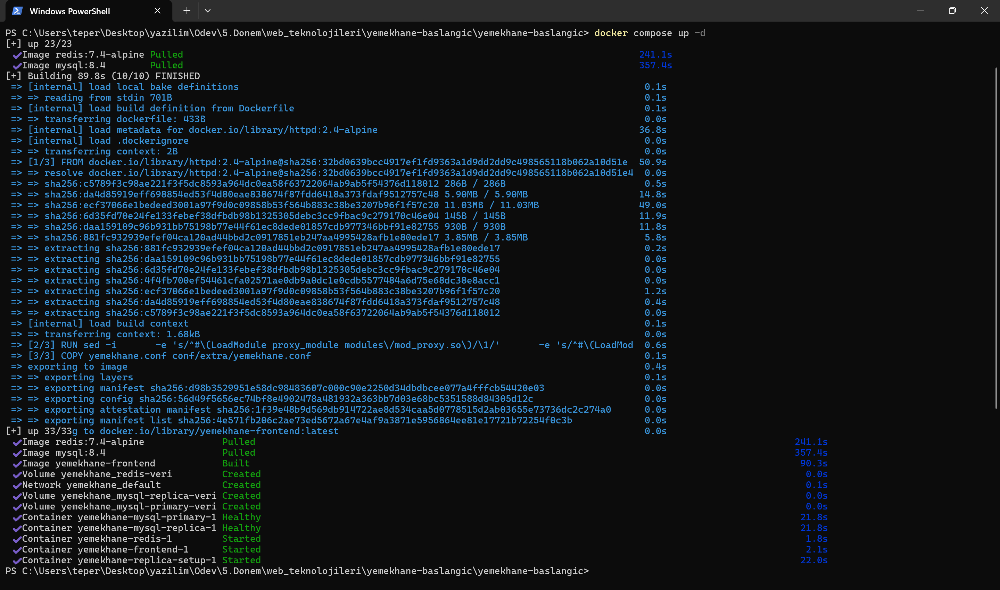

> **Şekil 1.1:** `docker compose up -d` çıktısı. İlk çalıştırmada `redis:7.4-alpine` ve
> `mysql:8.4` imajları Docker Hub'dan indirilmiş, `frontend` servisi ise `apache/Dockerfile`
> üzerinden yerel olarak derlenmiştir (`yemekhane-frontend` imajı). Üç kalıcı volume
> (`mysql-primary-veri`, `mysql-replica-veri`, `redis-veri`) ve servislerin birbirine ad
> üzerinden ulaştığı `yemekhane_default` ağı oluşturulmuştur. `mysql-primary` ve
> `mysql-replica` container'ları **Healthy** durumuna geçtikten sonra `replica-setup`
> başlatılmıştır; bu sıralama `depends_on: condition: service_healthy` ile sağlanır.

---

#### Adım 2: Servis Durumlarının Kontrolü

```powershell
docker compose ps -a
```


> **Şekil 1.2:** Tüm servislerin durum tablosu. `frontend`, `mysql-primary`,
> `mysql-replica` ve `redis` servisleri **`Up (healthy)`** durumundadır; yani her birinin
> `healthcheck` komutu (`wget`, `mysqladmin ping`, `redis-cli ping`) başarıyla yanıt
> vermektedir. `replica-setup` servisi **`Exited (0)`** durumundadır. Bu servis tek seferlik
> bir kurulum görevidir; replikasyonu kurup başarı koduyla (0) çıkması beklenen davranıştır.
> `mysql-replica` servisinin diğerlerinden daha kısa süredir çalışıyor görünmesi
> (_Up 7 minutes_), Adım 7'deki durdurma-başlatma testinden kaynaklanmaktadır; bu ekran
> görüntüsü testlerin tamamlanmasından sonra alınmıştır.

---

#### Adım 3: Web Arayüzüne Erişim

Tarayıcıdan `http://localhost:8080` adresine gidilmiştir.


> **Şekil 1.3:** Apache 2.4 tarafından sunulan başlangıç sayfası. Sayfa, servislerin
> görevlerini ve bilgisayardan erişim portlarını listelemektedir. Alt kısımdaki
> _"Uygulama servisi yanıt veriyor (HTTP 500)"_ bildirimi, `uygulama` servisinin bu aşamada
> henüz compose dosyasına eklenmemiş olmasından kaynaklanır: Apache, `/api/` isteğini
> `http://uygulama:8000` adresine iletmeye çalışmakta, ancak bu ada sahip bir container
> bulunmadığı için hata döndürmektedir. Uygulama servisi Aşama 2'de eklenecektir.

---

#### Adım 4: Replikasyon Durumunun Doğrulanması

```powershell
docker compose exec mysql-replica mysql -uroot -pyemekhane_kok -e "SHOW REPLICA STATUS\G"
```


> **Şekil 1.4:** Replika sunucusundaki replikasyon durumu. Kritik alanlar:
>
> | Alan                               | Değer                            | Anlamı                                                                |
> | ---------------------------------- | -------------------------------- | --------------------------------------------------------------------- |
> | `Replica_IO_Running`               | **Yes**                          | Kaynaktan binlog olaylarını çeken iş parçacığı çalışıyor              |
> | `Replica_SQL_Running`              | **Yes**                          | Alınan olayları replikaya uygulayan iş parçacığı çalışıyor            |
> | `Source_Host` / `Source_User`      | `mysql-primary` / `repl`         | Replika, kaynağa yalnızca replikasyon yetkili kullanıcıyla bağlanıyor |
> | `Seconds_Behind_Source`            | `0`                              | Ölçüm anında replika kaynağın gerisinde değil                         |
> | `Last_IO_Errno` / `Last_SQL_Errno` | `0` / `0`                        | Hata yok                                                              |
> | `Auto_Position`                    | `1`                              | GTID ile otomatik konumlandırma etkin                                 |
> | `Replica_SQL_Running_State`        | _Replica has read all relay log_ | Bekleyen işlem yok, yeni olaylar bekleniyor                           |

---

#### Adım 5: Kaynaktaki Yazmanın Replikaya Aktarılması

Önce replikadaki mevcut bakiye okunmuş, ardından kaynakta `sp_bakiye_yukle` yordamıyla
100 TL yükleme yapılmış ve replika tekrar sorgulanmıştır.

**5a. Replikada başlangıç bakiyesi**

```powershell
docker compose exec mysql-replica mysql -uyemekhane_app -pUyg_2026 yemekhane -e "SELECT id, bakiye FROM kullanicilar WHERE id = 7"
```


> **Şekil 1.5:** Yükleme öncesinde replikadan okunan bakiye: **355,00 TL**. Bu değer,
> karşılaştırma için referans noktasıdır.

**5b. Kaynakta 100 TL yükleme**

```powershell
docker compose exec mysql-primary mysql -uyemekhane_app -pUyg_2026 yemekhane -e "CALL sp_bakiye_yukle(7, 100)"
```


> **Şekil 1.6:** Yazma işlemi **kaynak sunucuya** (`mysql-primary`) gönderilmiştir. Para
> hareketi doğrudan `UPDATE` ile değil, ödevin kuralı gereği `sp_bakiye_yukle` stored
> procedure'ü ile yapılmıştır. Yordam, `bakiye_hareketleri` tablosuna **455** numaralı
> hareketi ekleyip kullanıcının yeni bakiyesini (**455,00 TL**) tek satır olarak döndürmüştür.

**5c. Replikada güncel bakiye**

```powershell
docker compose exec mysql-replica mysql -uyemekhane_app -pUyg_2026 yemekhane -e "SELECT id, bakiye FROM kullanicilar WHERE id = 7"
```

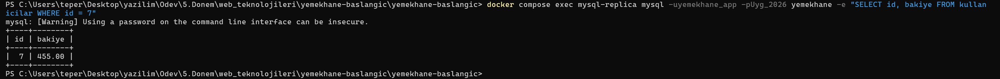

> **Şekil 1.7:** Aynı sorgu replikada tekrarlandığında bakiye **455,00 TL** olarak
> okunmuştur. Kaynakta yapılan yazma, herhangi bir elle müdahale olmadan replikaya
> aktarılmıştır (355 + 100 = 455).

---

#### Adım 6: Replikaya Yazma Denemesinin Reddedilmesi

```powershell
docker compose exec mysql-replica mysql -uyemekhane_app -pUyg_2026 yemekhane -e "CALL sp_bakiye_yukle(7, 50)"
```

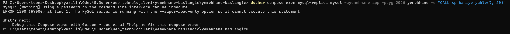

> **Şekil 1.8:** Replika üzerinde yazma denemesi
> **`ERROR 1290 (HY000): The MySQL server is running with the --super-read-only option`**
> hatasıyla reddedilmiştir. `replica-setup.sh` betiği replikada `read_only` ve
> `super_read_only` değişkenlerini `SET PERSIST` ile kalıcı olarak açmaktadır; bu nedenle
> ayar container yeniden başlatıldığında da korunur. Uygulama kullanıcısına replikada yazma
> yetkisi bilinçli olarak verilmiştir; böylece reddin sebebinin **yetki eksikliği değil,
> sunucunun salt okunur olması** olduğu açıkça görülmektedir. Bu sayede uygulama
> katmanındaki bir hata sonucu yanlışlıkla replikaya yazılması veritabanı düzeyinde
> engellenmiş olur.

---

#### Adım 7: Kesinti Sonrası Değişikliklerin Yakalanması

Replika container'ı durdurulmuş, replika kapalıyken kaynakta 200 TL yükleme yapılmış,
ardından replika yeniden başlatılarak bakiye sorgulanmıştır.

```powershell
docker compose stop mysql-replica
docker compose exec mysql-primary mysql -uyemekhane_app -pUyg_2026 yemekhane -e "CALL sp_bakiye_yukle(7, 200)"
docker compose start mysql-replica
docker compose exec mysql-replica mysql -uyemekhane_app -pUyg_2026 yemekhane -e "SELECT id, bakiye FROM kullanicilar WHERE id = 7"
```

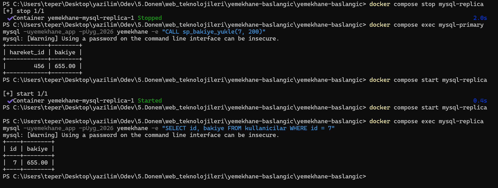

> **Şekil 1.9:** Dört adımlık kesinti testi:
>
> 1. `mysql-replica` durduruldu (**Stopped**).
> 2. Replika kapalıyken kaynakta 200 TL yüklendi; hareket **456**, kaynaktaki bakiye **655,00 TL**.
> 3. `mysql-replica` yeniden başlatıldı (**Started**).
> 4. Replikada sorgulanan bakiye **655,00 TL** oldu (455 + 200 = 655).
>
> Replika, yeniden başladığında kaynağa bağlanmış ve GTID kümesini karşılaştırarak kapalı
> olduğu sürede kaçırdığı işlemi kendiliğinden almış ve uygulamıştır. Herhangi bir elle
> senkronizasyon gerekmemiştir. Bu davranış, replikanın kaynak çöktüğünde güncel bir yedek
> olarak kullanılabilmesinin temelidir.

---

#### Adım 8: Redis Erişimi

```powershell
docker compose exec redis redis-cli ping
```

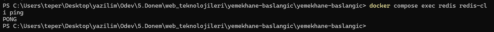

> **Şekil 1.10:** Redis sunucusu `PING` komutuna **`PONG`** yanıtı vermiştir. Redis, AOF
> (`--appendonly yes`) kalıcılığıyla çalışmaktadır; Aşama 3'te menü önbelleği ve oturum
> deposu olarak kullanılacaktır.

---

### 1.5 Bakiye Akışının Özeti

| Adım | İşlem                                         | Sunucu  | Hareket No | Bakiye                      |
| ---- | --------------------------------------------- | ------- | ---------- | --------------------------- |
| 5a   | Başlangıç okuma                               | Replika | -          | 355,00 TL                   |
| 5b   | `sp_bakiye_yukle(7, 100)`                     | Kaynak  | 455        | 455,00 TL                   |
| 5c   | Okuma                                         | Replika | -          | 455,00 TL                   |
| 6    | `sp_bakiye_yukle(7, 50)`                      | Replika | -          | **Reddedildi** (ERROR 1290) |
| 7    | Replika durduruldu, `sp_bakiye_yukle(7, 200)` | Kaynak  | 456        | 655,00 TL                   |
| 7    | Replika başlatıldı, okuma                     | Replika | -          | 655,00 TL                   |

Replikaya yapılan 50 TL'lik deneme reddedildiği için bakiyeye yansımamıştır; son bakiye
yalnızca kaynakta yapılan iki yüklemeyi içermektedir: **355 + 100 + 200 = 655 TL**.

### 1.6 Sonuç

Başlangıç paketi `docker compose up -d` komutuyla ek bir adım gerektirmeden çalışmış ve
beş servisin tamamı beklenen duruma ulaşmıştır. MySQL kaynak-replika replikasyonu GTID
tabanlı olarak çalışmakta; yazma işlemleri kaynakta yapılıp kısa süre içinde replikaya
aktarılmakta (replikasyon eşzamansız olduğundan bu aktarım anlık değildir; etkisi Aşama 2'de
ele alınacaktır), replika salt okunur olduğu için yazma girişimlerini reddetmekte ve kesinti
sonrasında kaçırdığı değişiklikleri otomatik olarak yakalamaktadır. Altyapı, Aşama 2'de
eklenecek uygulama servisinin okuma/yazma trafiğini ayırabilmesi için hazırdır.

---

## Aşama 2: Uygulama

### 2.1 Amaç

Bu aşamada başlangıç paketine `uygulama` servisi eklenmiş; ödevde istenen yedi ekran
(giriş/çıkış, günün menüsü, haftalık menü ve rezervasyon, rezervasyonlarım, bakiye,
değerlendirme, yönetici paneli) bir Web API ve bu API'yi `fetch` ile kullanan HTML5 + CSS3
arayüzü olarak yazılmıştır. Yazma işlemleri kaynak sunucuya, listeleme ve raporlar replikaya
gönderilmekte; para hareketleri yalnızca başlangıç paketindeki stored procedure'lerle
yapılmakta; yordamların Türkçe hata mesajları değiştirilmeden arayüze taşınmaktadır.

### 2.2 Seçilen Yol ve Teknolojiler

**Seçilen yol: Web API + arayüz.** API yalnızca JSON döner. Arayüz `frontend`
container'ındaki Apache'den sunulan düz HTML5, CSS3 ve JavaScript (ES modülleri) dosyalarıdır;
veriyi `fetch` ile alır, React gibi bir çerçeve kullanılmaz. Apache, `-D WEBAPI` moduyla
`/api/` ile başlayan istekleri `http://uygulama:8000/api/` adresine iletir.

| Katman     | Teknoloji                                                             |
| ---------- | --------------------------------------------------------------------- |
| API        | Node.js 24 (`node:24-alpine`), Express 5                              |
| Veritabanı | `mysql2/promise`: iki bağlantı havuzu (yazma: kaynak, okuma: replika) |
| Parola     | `bcryptjs` (veritabanındaki `sifre_hash` alanı bcrypt özetidir)       |
| Arayüz     | HTML5, CSS3 (`@layer` katmanları), JavaScript ES modülleri, `fetch`   |
| Sunucu     | Apache 2.4 (`frontend`), `/api/` isteklerini `uygulama:8000`'e iletir |

`docker-compose.yml` dosyasında `uygulama` servisi `./uygulama/Dockerfile` ile derlenir,
container içinde 8000 portunu dinler ve `mysql-primary`, `redis` sağlıklı ve `replica-setup`
başarıyla bitmeden başlamaz. Bağlantı bilgileri ortam değişkenlerinden okunur
(`DB_YAZMA_HOST=mysql-primary`, `DB_OKUMA_HOST=mysql-replica`).

```powershell
docker compose up -d --build
docker compose ps -a
```

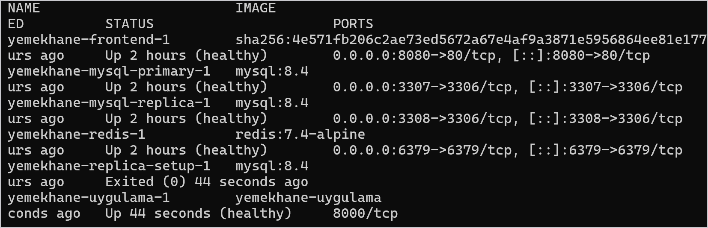

> **Şekil 2.1:** `docker compose ps -a` çıktısından yakınlaştırma. Aşama 1'deki beş servise
> ek olarak `yemekhane-uygulama-1` container'ı **`Up (healthy)`** durumundadır; sağlık
> kontrolü `wget http://127.0.0.1:8000/api/` isteğidir. `replica-setup` beklendiği gibi
> **`Exited (0)`** durumundadır.

```powershell
docker compose logs uygulama
```

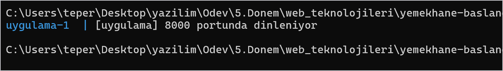

> **Şekil 2.2:** `docker compose logs uygulama` çıktısı: API 8000 portunda dinlemeye başlamıştır.

### 2.3 Katmanlı Yapı

```
uygulama/src/
├── server.js, app.js          # Express uygulaması, route'ların bağlanması
├── config/db.js               # yazmaHavuzu (mysql-primary) ve okumaHavuzu (mysql-replica)
├── routes/                    # URL ve HTTP yöntemine göre middleware ve controller eşlemesi
├── middleware/                # oturumGerekli (401), yoneticiGerekli (403), hata yakalayıcı
├── controllers/               # istek parametrelerinin doğrulanması (400), yanıt kodu
├── services/                  # iş kuralları (rol fiyatı, "yalnızca kullanılan menü", 403/404/409)
├── repositories/              # SQL sorguları ve CALL sp_... (yalnızca burada SQL vardır)
└── utils/                     # istekHatasi, ortak doğrulama fonksiyonları
```

Altı kaynak (`auth`, `menu`, `rezervasyon`, `bakiye`, `degerlendirme`, `yonetici`) bu
dört katmanın her birinde ayrı bir dosyaya sahiptir. **Controller'larda SQL yoktur**; SQL
yalnızca `repositories/` klasöründedir. **Arayüz kodunda iş kuralı yoktur**: fiyatın role
göre seçilmesi, rezervasyon son saati, "bugün" ve haftanın günleri, iptal edilebilirlik,
doluluk ve ortalama puan API'de ya da veritabanında hesaplanır; arayüz gelen değeri gösterir.
Arayüzün kendi yaptığı karşılaştırmalar yalnızca görünümle ilgilidir (ör. yönetici tablosunda
"Oluştur" düğmesinin gösterilmesi); aynı kural kayıt sırasında API'de yeniden denetlenir.

### 2.4 Bir İsteğin Uygulama İçindeki Yolu: `POST /api/rezervasyonlar`

Haftalık menüde bir günün penceresinde **Rezervasyon yap** düğmesine basıldığında (Şekil
2.15) istek aşağıdaki katmanlardan geçer.

**1. Arayüz** (`frontend/js/sayfalar/menu.js`) isteği `fetch` ile gönderir; `api()` fonksiyonu
oturum anahtarını `Authorization: Bearer ...` başlığına ekler:

```js
const sonuc = await api("/rezervasyonlar", {
  method: "POST",
  govde: { menu_id: menu.id },
});
```

**2. Apache** (`frontend`) `/api/` ile başlayan isteği `http://uygulama:8000/api/rezervasyonlar`
adresine iletir.

**3. Route** (`routes/rezervasyonRoutes.js`) önce oturumu doğrular, sonra controller'ı çağırır:

```js
router.post("/rezervasyonlar", oturumGerekli, rezervasyonController.olustur);
```

**4. Controller** (`controllers/rezervasyonController.js`) yalnızca girdiyi denetler; SQL içermez:

```js
async function olustur(req, res) {
  const menuId = pozitifTamSayi(req.body?.menu_id);
  if (!menuId) {
    throw istekHatasi(400, "Geçersiz menü.");
  }

  const sonuc = await rezervasyonService.rezervasyonYap(
    req.oturum.kullaniciId,
    menuId,
  );
  res.status(201).json(sonuc);
}
```

**5. Service** (`services/rezervasyonService.js`) veri katmanından gelen satırı yanıt
biçimine dönüştürür:

```js
async function rezervasyonYap(kullaniciId, menuId) {
  const sonuc = await rezervasyonRepository.rezervasyonYap(kullaniciId, menuId);
  return {
    rezervasyon_id: sonuc.rezervasyon_id,
    ucret: sonuc.ucret,
    bakiye: sonuc.bakiye,
    mesaj: "Rezervasyon oluşturuldu.",
  };
}
```

**6. Veri katmanı** (`repositories/rezervasyonRepository.js`) **yazma havuzu** üzerinden kaynak
sunucudaki yordamı çağırır. Bakiye düşme, kapasite ve son saat kontrolü, hareket kaydı
yordamın kendi transaction'ı içindedir; uygulama bunları ayrıca yapmaz ve `CALL`'u
BEGIN/COMMIT içine almaz:

```js
async function rezervasyonYap(kullaniciId, menuId) {
  const [sonuclar] = await yazmaHavuzu.query("CALL sp_rezervasyon_yap(?, ?)", [
    kullaniciId,
    menuId,
  ]);
  return sonuclar[0][0];
}
```

**7. Yanıt.** Şekil 2.15 - 2.16'daki rezervasyonda API şu yanıtı döndürmüştür
(`201 Created`):

```json
{
  "rezervasyon_id": 372,
  "ucret": 40,
  "bakiye": 565,
  "mesaj": "Rezervasyon oluşturuldu."
}
```

Arayüz `bakiye` değerini üst menüye ve pencereye yazar, boş yer sayısını bir azaltır ve
karta **Rezerve** rozeti ekler.

**Hata yolu.** Yordam bir kuralı ihlal ederse (`SIGNAL SQLSTATE '45000'`) MySQL **1644**
hata koduyla Türkçe bir mesaj döner. Bu hata route → controller → service → repository
zincirinde yakalanmadan yukarı çıkar ve `middleware/hata.js` içindeki ortak yakalayıcıda
mesajı **değiştirilmeden** `400` yanıtına dönüştürülür:

```js
if (err.errno === 1644) {
  return res.status(400).json({ hata: err.sqlMessage });
}
```

Arayüz `hata` alanını olduğu gibi gösterir (Şekil 2.17 - 2.18: _"Bakiye yetersiz."_).
Kullanıcıya gösterilmemesi gereken diğer veritabanı hataları (ör. 3819, `CHECK` ihlali)
yalnızca sunucu günlüğüne yazılır ve istemciye genel bir `500` mesajı gider.

### 2.5 Okuma / Yazma Ayrımı

`config/db.js` dosyası iki ayrı bağlantı havuzu açar. Hangi havuzun kullanılacağına veri
katmanı karar verir:

```js
const yazmaHavuzu = mysql.createPool({
  ...ortakAyarlar,
  host: process.env.DB_YAZMA_HOST,
});
const okumaHavuzu = mysql.createPool({
  ...ortakAyarlar,
  host: process.env.DB_OKUMA_HOST,
});
```

| İşlem                                                                               | Havuz         | Sunucu          |
| ----------------------------------------------------------------------------------- | ------------- | --------------- |
| Giriş (kullanıcı arama), haftalık menü, günün menüsü, yorumlar, rezervasyon listesi | `okumaHavuzu` | `mysql-replica` |
| Bakiye sayfası, hareket geçmişi, yönetici doluluk ve puan raporu                    | `okumaHavuzu` | `mysql-replica` |
| `sp_rezervasyon_yap`, `sp_rezervasyon_iptal`, `sp_bakiye_yukle`                     | `yazmaHavuzu` | `mysql-primary` |
| Değerlendirme kaydı, yönetici menü oluşturma ve düzenleme (tek transaction)         | `yazmaHavuzu` | `mysql-primary` |
| Yazmadan hemen sonra gösterilen bakiye, ortalama puan, yorumlar, kaydedilen menü    | `yazmaHavuzu` | `mysql-primary` |

Tarayıcıdan `http://localhost:8080/api/saglik` adresi açılmıştır.

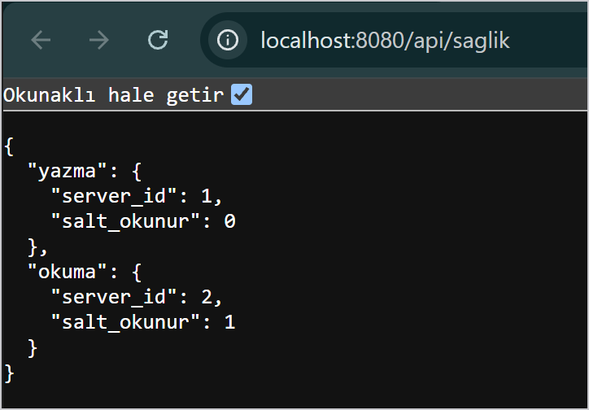

> **Şekil 2.3:** `GET /api/saglik` yanıtı. Uygulama her iki havuzda da
> `SELECT @@server_id, @@read_only` sorgusunu çalıştırır: yazma havuzu
> **`server_id = 1`** olan ve yazılabilir (`salt_okunur: 0`) kaynak sunucuya, okuma havuzu ise
> **`server_id = 2`** olan ve salt okunur (`salt_okunur: 1`) replikaya bağlıdır.

Tarayıcıdan tanımlı olmayan `http://localhost:8080/api/olmayan-yol` adresi açılmıştır.

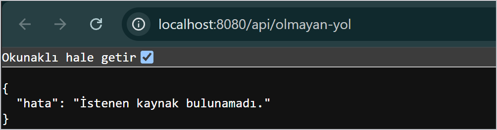

> **Şekil 2.4:** Tanımlı olmayan bir API yolu, Express'in HTML hata sayfası yerine JSON
> biçiminde `404` yanıtı döner. Arayüz tüm hataları aynı `{ "hata": "..." }` biçiminde okur.

### 2.6 Replikasyon Gecikmesi ve Rezervasyon Sonrası Bakiye

MySQL replikasyonu **eşzamansızdır**: kaynak sunucu bir işlemi kendi tarafında tamamlayıp
istemciye yanıt verdikten sonra değişikliği binlog üzerinden replikaya gönderir; replika bu
olayı kısa bir süre sonra (genellikle milisaniyeler, yük altında saniyeler) uygular. Okumalar
replikadan yapıldığı için, rezervasyonun hemen ardından bakiye replikadan okunsaydı replika
yeni satırı henüz almamış olabilir ve kullanıcı **düşülmemiş, eski bakiyeyi** görürdü; işlemin
gerçekleşmediğini düşünüp tekrar denemesi ya da tutarsız bir ekranla karşılaşması mümkün
olurdu. Bu nedenle rezervasyondan hemen sonra gösterilen bakiye replikadan değil,
`sp_rezervasyon_yap` yordamının **kaynak sunucuda, aynı transaction içinde** hesaplayıp
döndürdüğü değerdir (Şekil 2.16: _"Yeni bakiye: 565,00 TL"_). Aynı ilke iptalde
(`sp_rezervasyon_iptal`), bakiye yüklemede (`sp_bakiye_yukle`), değerlendirmeden sonraki
ortalama puan ve yorumlarda ve yöneticinin kaydettiği menüde de uygulanmıştır: yazmanın
sonucu kaynaktan alınır, arayüz listeyi replikadan yeniden okumak yerine yerelde günceller.
Menüden iptal sayfasına yönlendirmede kayıt replikada henüz yoksa sayfa bir saniye bekleyip
bir kez daha okur.

### 2.7 Stored Procedure Kullanımı ve Hata Mesajları

| Ekran            | Yordam                                       | Arayüze taşınan hata mesajı örnekleri                                                        |
| ---------------- | -------------------------------------------- | -------------------------------------------------------------------------------------------- |
| Haftalık menü    | `sp_rezervasyon_yap(kullanici_id, menu_id)`  | "Bakiye yetersiz.", "Bu menü için rezervasyon süresi doldu.", "Yemekhane kapasitesi dolu."   |
| Rezervasyonlarım | `sp_rezervasyon_iptal(kullanici_id, rez_id)` | "Bu rezervasyon için iptal süresi doldu.", "Yalnızca aktif rezervasyonlar iptal edilebilir." |
| Bakiye           | `sp_bakiye_yukle(kullanici_id, tutar)`       | "Yükleme tutarı 10 ile 1000 TL arasında olmalıdır." (Şekil 2.25 - 2.26)                      |

Para hareketi içeren hiçbir işlem uygulamada `UPDATE` ile yapılmaz. 10-1000 TL sınırı
bilerek controller'da tekrarlanmamıştır; controller yalnızca girdinin sayı olup olmadığını
denetler, sınır kuralı yordamdadır ve mesajı olduğu gibi arayüze ulaşır. Menü kartlarındaki
doluluk ve puan bilgisi hazır view'lardan (`v_menu_detay`, `v_menu_doluluk`, `v_menu_puan`)
okunur.

---

### 2.8 Ekranlar

#### Ekran 1: Giriş ve Çıkış

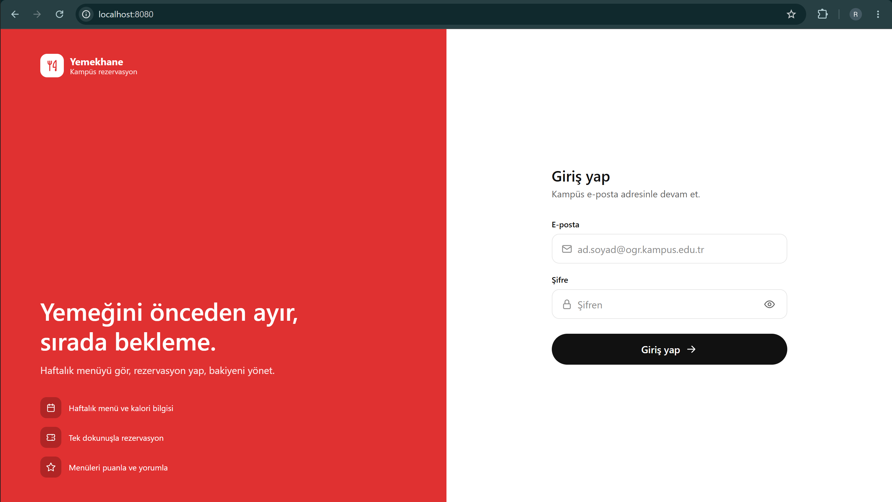

> **Şekil 2.5:** Giriş ekranı (masaüstü). `POST /api/giris` isteği e-posta ile kullanıcıyı
> replikadan bulur ve parolayı `bcrypt.compare` ile `sifre_hash` alanına karşı doğrular.

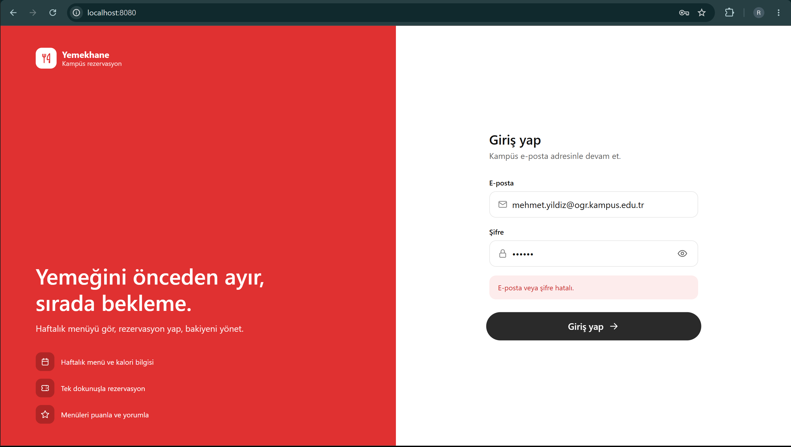

> **Şekil 2.6:** Yanlış parola: API `401` ve _"E-posta veya şifre hatalı."_ döner; arayüz mesajı
> form altında gösterir. Kullanıcının var olup olmadığı mesajdan anlaşılmaz.

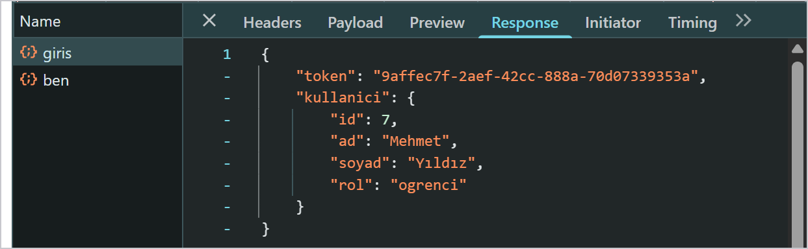

> **Şekil 2.7:** Tarayıcının ağ panelinde `giris` isteğinin yanıtı (yakınlaştırma): API bir
> oturum anahtarı (`token`) ve kullanıcının adı, soyadı ve rolünü döner; parola özeti yanıtta
> yer almaz. Anahtar sonraki isteklerde `Authorization` başlığıyla gönderilir. Çıkış
> (`POST /api/cikis`) oturumu sunucuda siler; her sayfada üst menüdeki çıkış düğmesiyle yapılır.

#### Ekran 2: Günün Menüsü

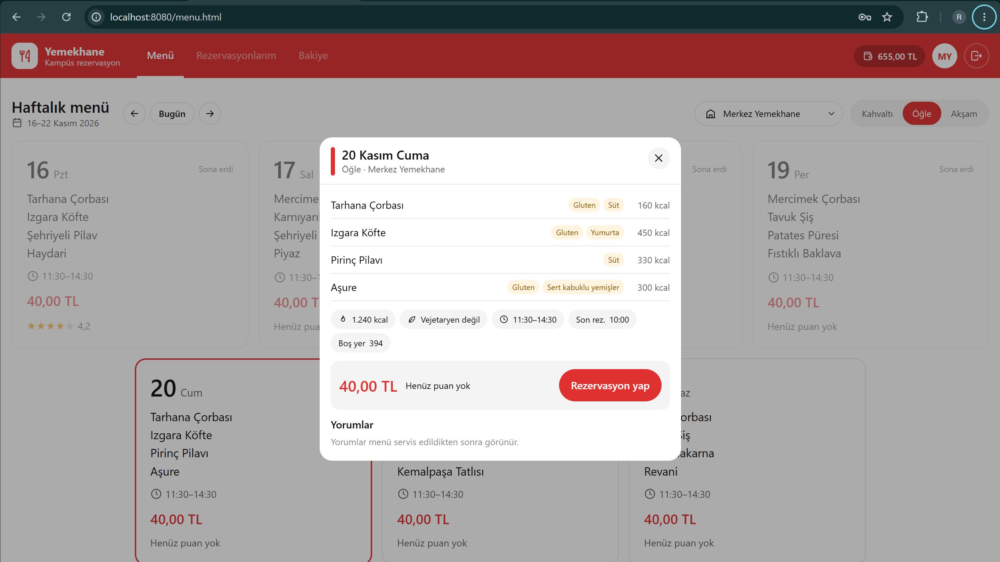

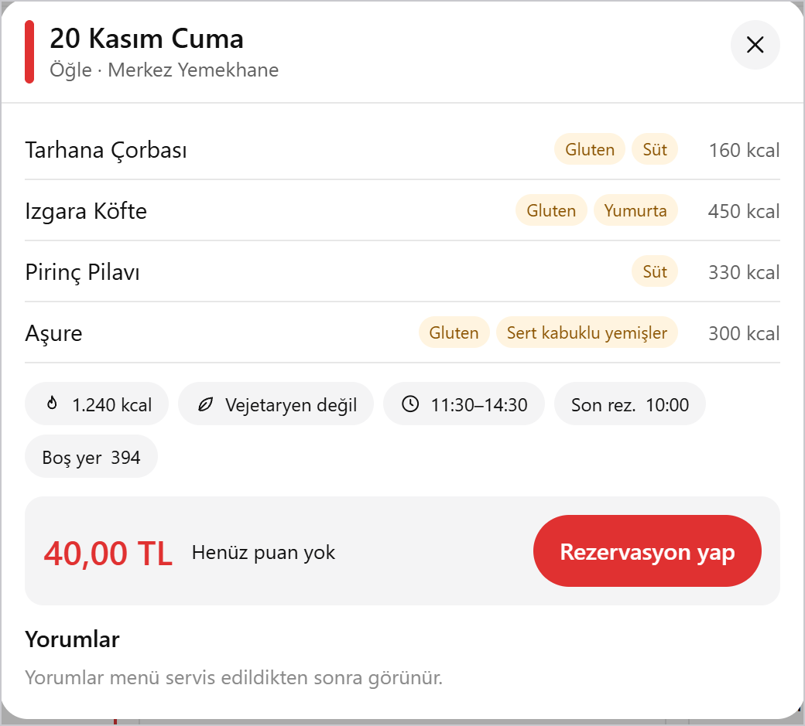

> **Şekil 2.8 ve 2.9:** Bugünün (20 Kasım, Öğle, Merkez Yemekhane) menü penceresi ve
> yakınlaştırması. Her yemeğin yanında alerjen etiketleri (_Gluten, Süt, Yumurta, Sert kabuklu
> yemişler_) ve kalorisi, altta **toplam kalori (1.240 kcal)**, **vejetaryen bilgisi**, servis
> saati, rezervasyon son saati ve boş yer sayısı yer alır. Veriler `GET /api/menu` ile
> `v_menu_detay` view'ından gelir.

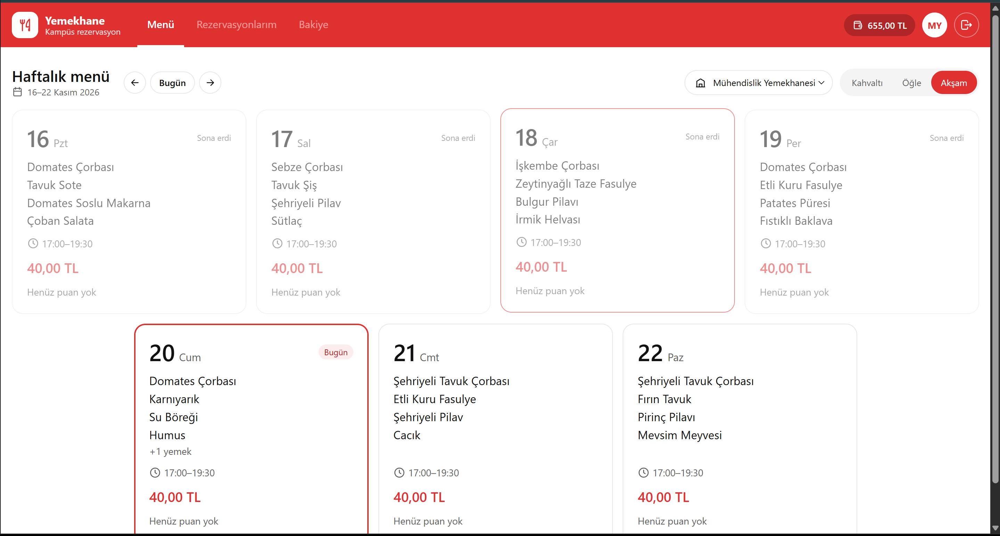

> **Şekil 2.10:** Yemekhane (Mühendislik Yemekhanesi) ve öğün (Akşam) seçimi değiştirildiğinde
> hafta yeniden yüklenir.

#### Ekran 3: Haftalık Menü ve Rezervasyon

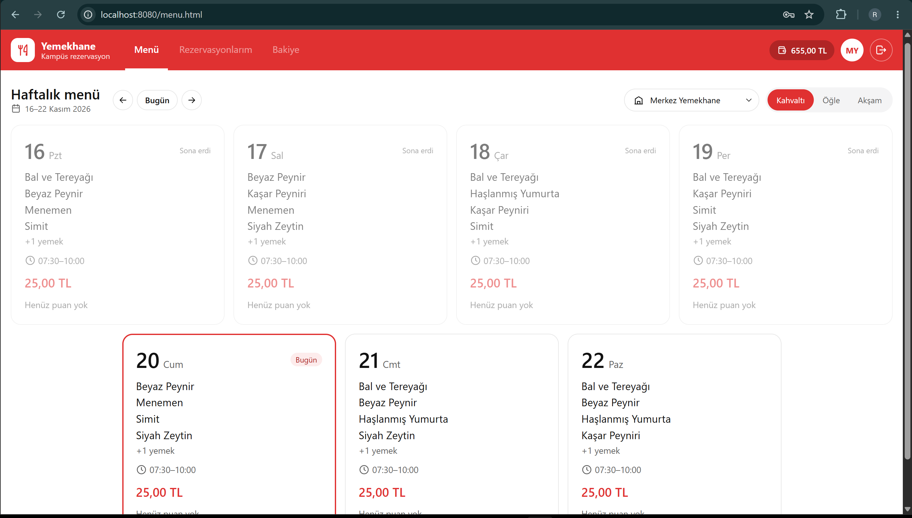

> **Şekil 2.11:** Haftalık menü (16-22 Kasım, Kahvaltı). Haftanın başı, sonu ve "bugün"
> MySQL tarafından hesaplanır; geçmiş günler _Sona erdi_ olarak soluk gösterilir.

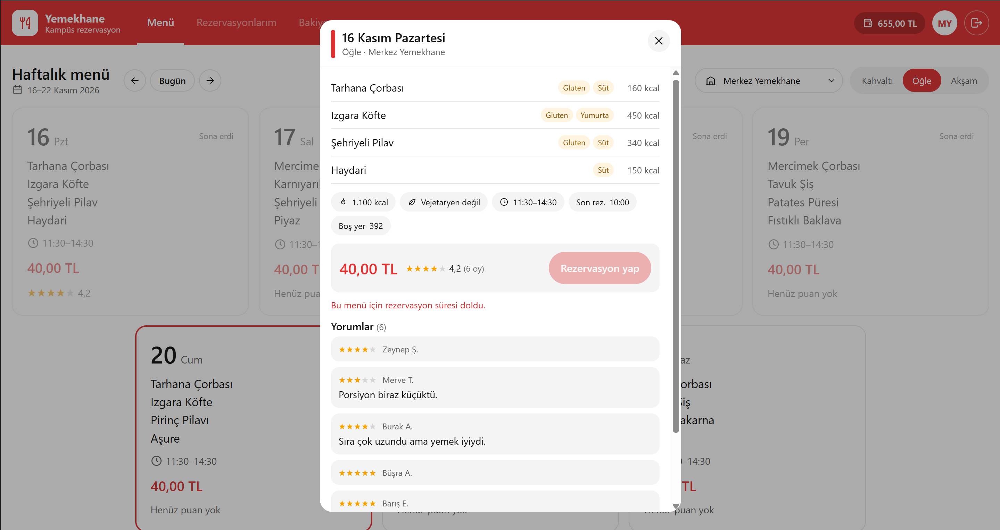

> **Şekil 2.12:** Son saati geçmiş bir günün penceresi: **Rezervasyon yap** düğmesi pasiftir
> ve _"Bu menü için rezervasyon süresi doldu."_ uyarısı görünür. Pencerede menünün yorumları da
> listelenir.

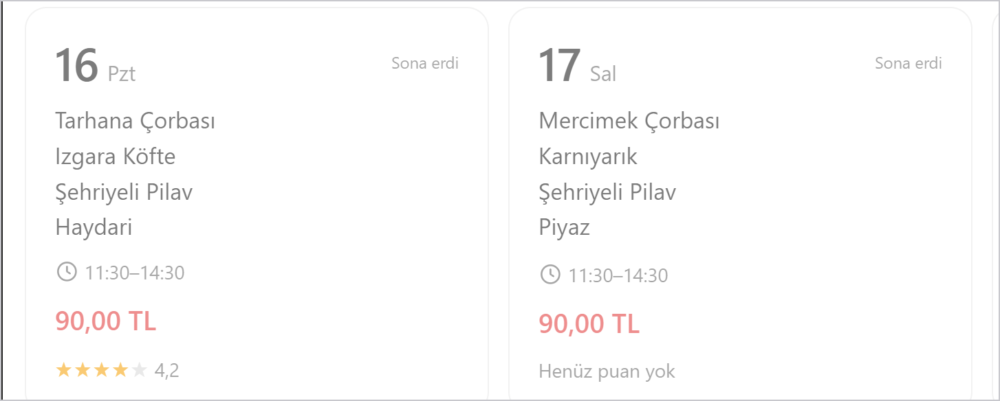

> **Şekil 2.13:** Personel rolündeki kullanıcıyla girişte aynı öğle menüsünün fiyatı
> **90,00 TL** görünür (öğrenciye 40,00 TL). Fiyat seçimi `menuService` içinde role göre yapılır.

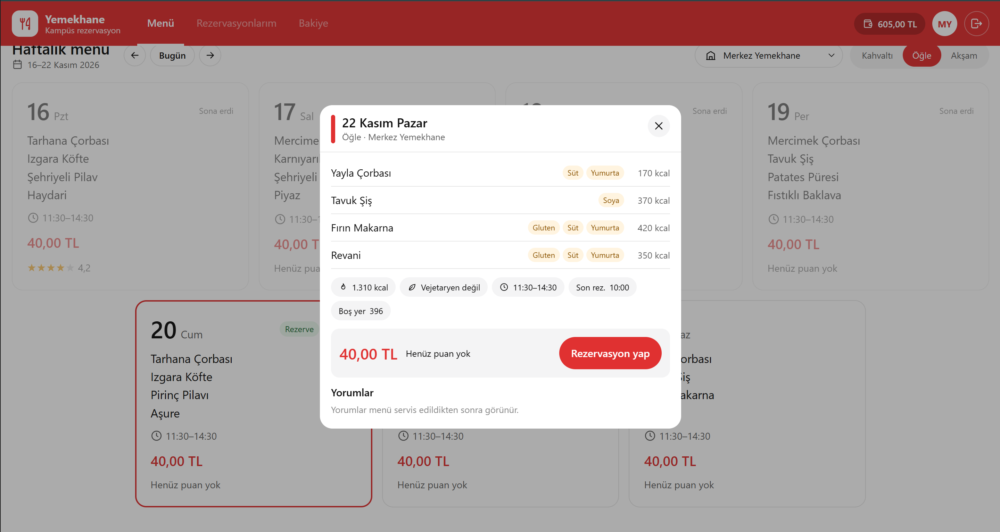

> **Şekil 2.14:** Rezervasyon öncesi: üst menüde bakiye **605,00 TL**, 22 Kasım Öğle
> penceresinde **Rezervasyon yap** düğmesi etkin.

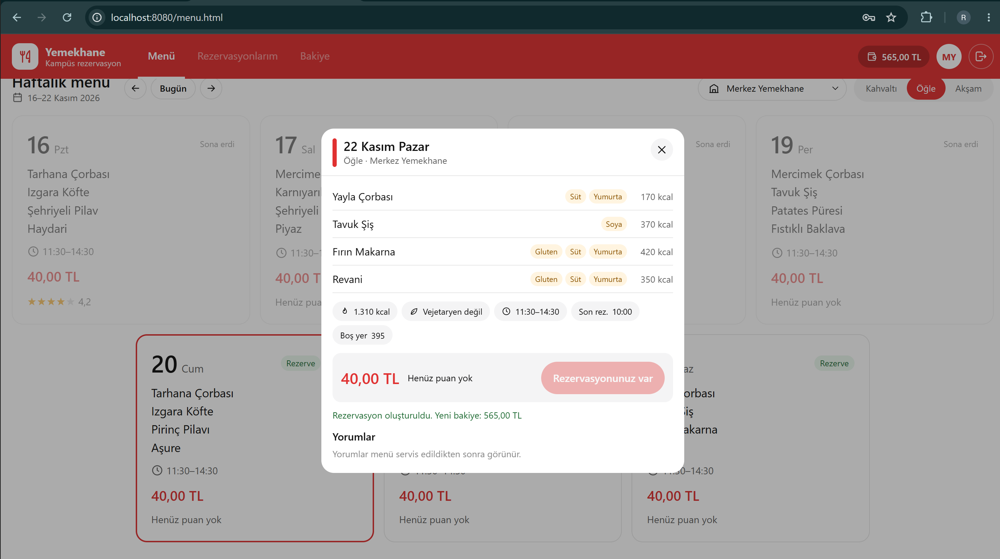

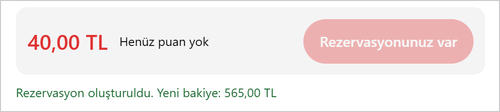

> **Şekil 2.15 ve 2.16:** Başarılı rezervasyon. Yeşil mesaj _"Rezervasyon oluşturuldu. Yeni
> bakiye: 565,00 TL"_ ve üst menüdeki bakiye, yordamın kaynakta döndürdüğü değerdir
> (605 - 40 = 565). Düğme _Rezervasyonunuz var_ olarak pasifleşmiş, kartlara **Rezerve**
> rozeti eklenmiştir.

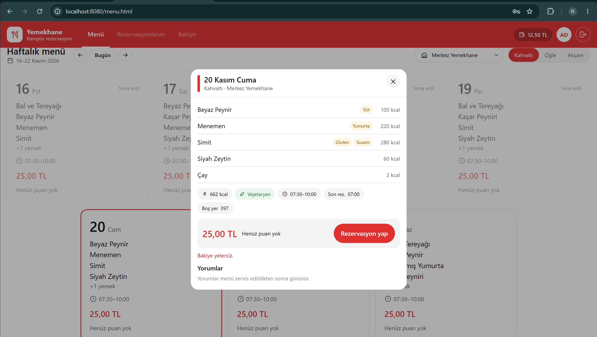


> **Şekil 2.17 ve 2.18:** Bakiyesi 12,50 TL olan öğrencinin 25,00 TL'lik kahvaltıya rezervasyon
> denemesi. Mesaj _"Bakiye yetersiz."_ `sp_rezervasyon_yap` içindeki `SIGNAL` ifadesinden
> gelir ve arayüze değiştirilmeden taşınır.

#### Ekran 4: Rezervasyonlarım

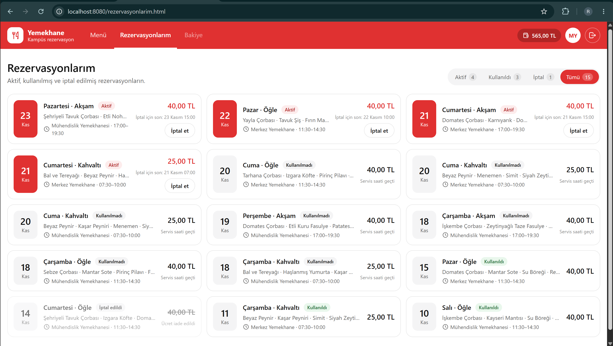

> **Şekil 2.19:** Tüm rezervasyonlar: **Aktif**, **Kullanıldı**, **İptal edildi** ve
> **Kullanılmadı** rozetleri; aktif ve son saati geçmemiş kayıtlarda **İptal et** düğmesi ve
> _"İptal için son: ..."_ notu. İptal edilebilirlik (`iptal_edilebilir`) MySQL'de hesaplanır.

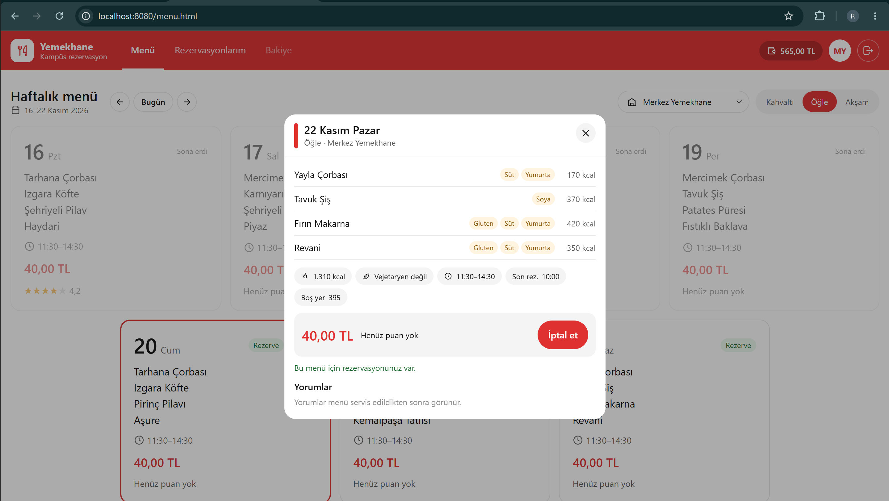

> **Şekil 2.20:** Menü sayfasında rezervasyonu olan bir günün penceresinde düğme
> **İptal et** olur ve kullanıcıyı ilgili rezervasyonun detayı açık şekilde Rezervasyonlarım
> sayfasına yönlendirir.

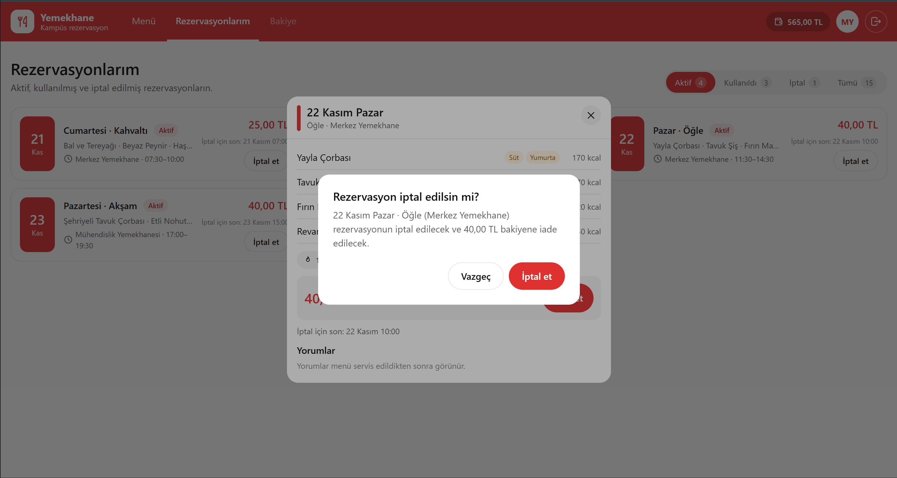

> **Şekil 2.21:** İptal onay penceresi; iade edilecek tutar önceden gösterilir.

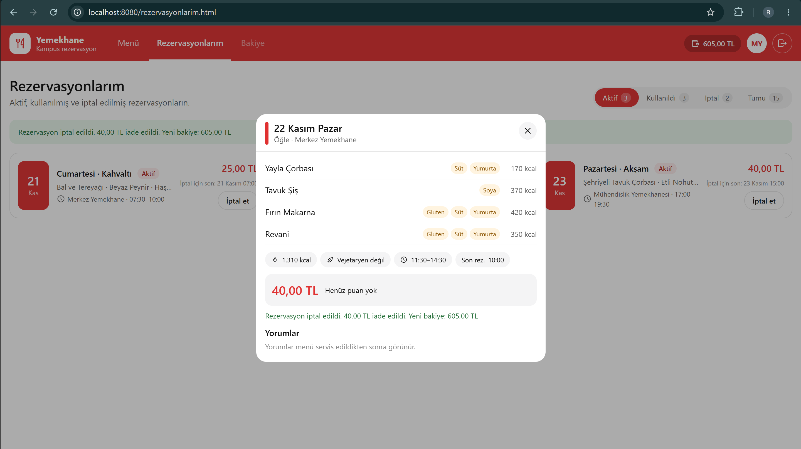

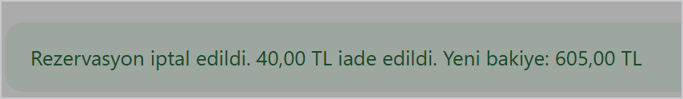

> **Şekil 2.22 ve 2.23:** İptalden sonra: _"Rezervasyon iptal edildi. 40,00 TL iade edildi.
> Yeni bakiye: 605,00 TL"_. İade `sp_rezervasyon_iptal` ile yapılmış, yeni bakiye kaynaktan
> alınmıştır (565 + 40 = 605).

#### Ekran 5: Bakiye

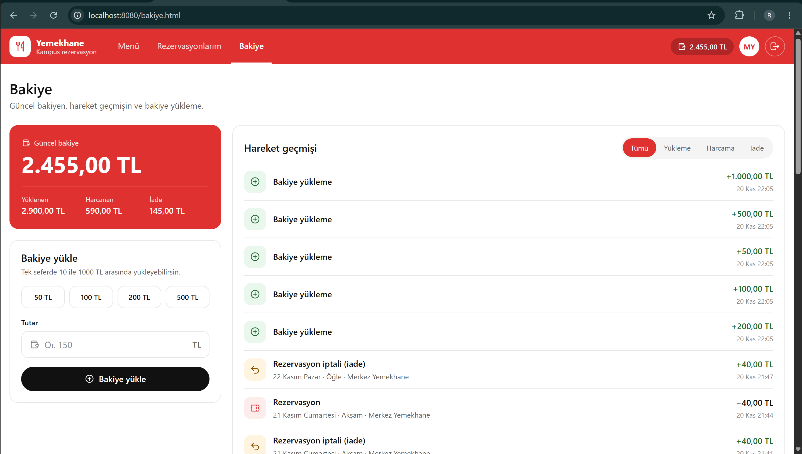

> **Şekil 2.24:** Bakiye sayfası: güncel bakiye, yüklenen / harcanan / iade toplamları, hızlı
> tutarlı yükleme formu ve filtrelenebilir hareket geçmişi (yükleme, rezervasyon, iade).

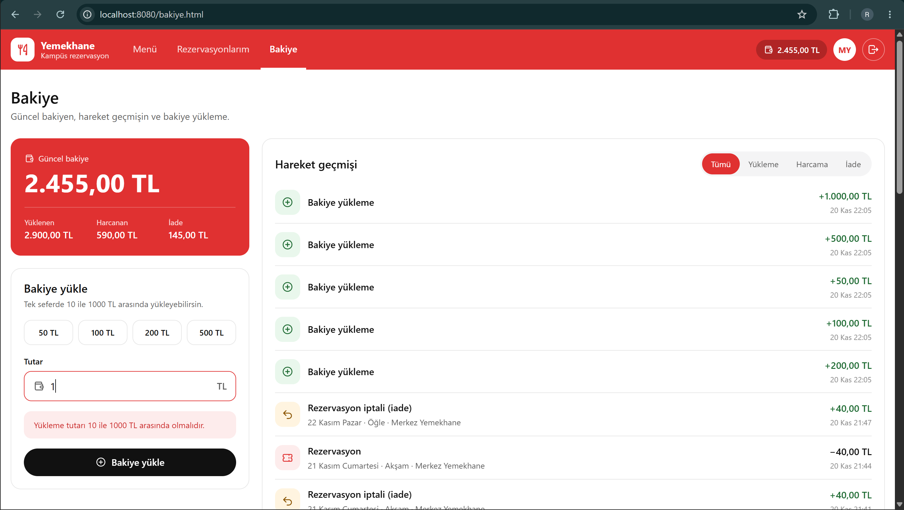

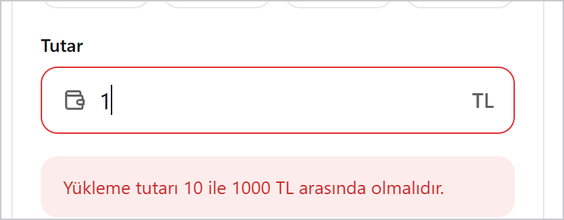

> **Şekil 2.25 ve 2.26:** 1 TL yükleme denemesi. Mesaj _"Yükleme tutarı 10 ile 1000 TL arasında
> olmalıdır."_ `sp_bakiye_yukle` yordamından gelir.

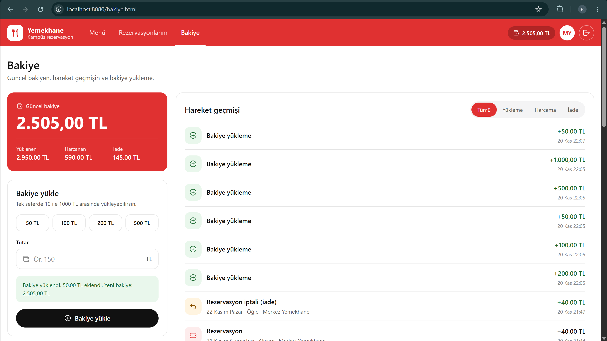

> **Şekil 2.27:** 50 TL yükleme: _"Bakiye yüklendi. 50,00 TL eklendi. Yeni bakiye: 2.505,00 TL"_
> (2.455 + 50). Yeni hareket listenin başına eklenmiştir.

#### Ekran 6: Değerlendirme

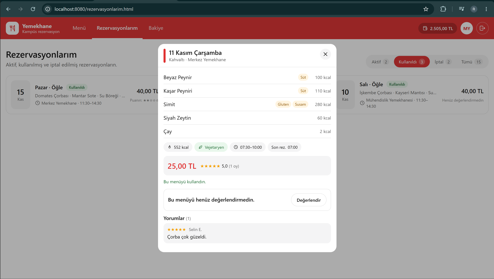

> **Şekil 2.28:** Kullanılmış (turnikeden geçilmiş) bir menünün penceresinde _"Bu menüyü henüz
> değerlendirmedin."_ ve **Değerlendir** düğmesi. Değerlendirme yalnızca `kullanildi`
> durumundaki rezervasyonlar için mümkündür; kural `degerlendirmeService` içinde kaynak
> sunucuda denetlenir, aksi hâlde `403` döner.

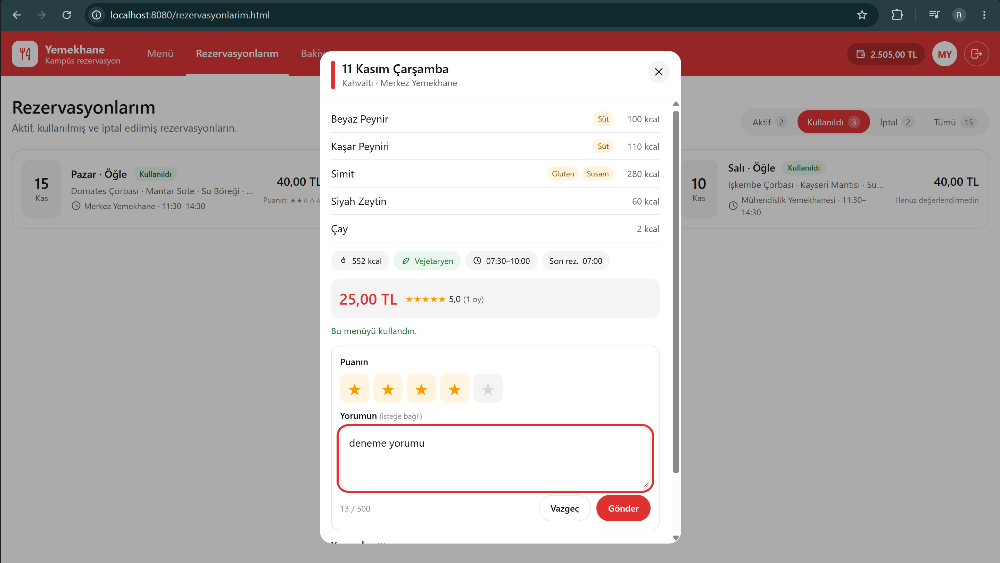

> **Şekil 2.29:** 1-5 yıldız ve en fazla 500 karakterlik yorum formu.

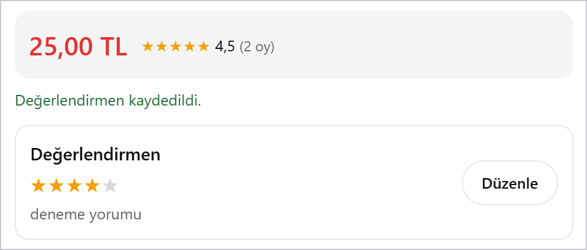

> **Şekil 2.30:** Kayıttan sonra (yakınlaştırma): _"Değerlendirmen kaydedildi."_, kullanıcının
> 4 yıldızlı değerlendirmesi ve menünün yeni ortalaması **4,5 (2 oy)**. Ortalama ve yorumlar
> kaynaktan okunmuştur.

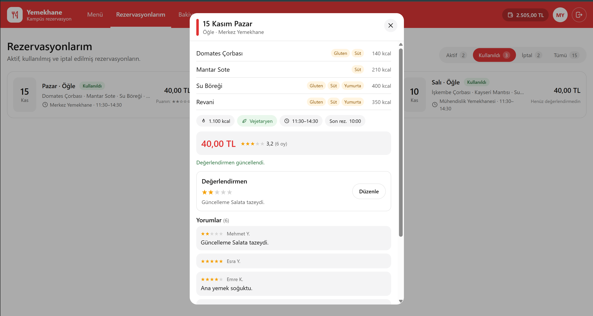

> **Şekil 2.31:** Kişi başına tek değerlendirme kuralı (`UNIQUE (kullanici_id, menu_id)`)
> korunarak değerlendirme düzenlenebilir; ikinci gönderimde `INSERT ... ON DUPLICATE KEY UPDATE`
> ile puan ve yorum güncellenir (_"Değerlendirmen güncellendi."_).

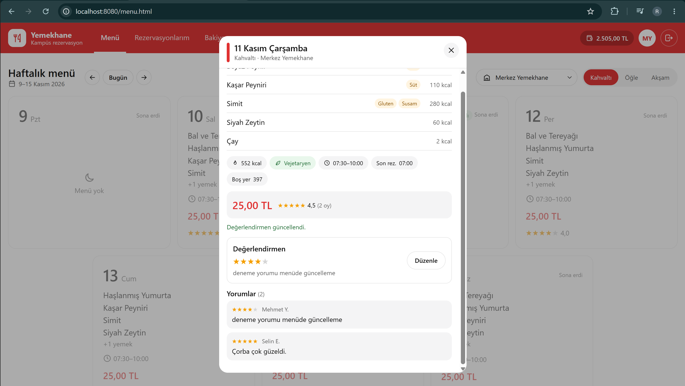

> **Şekil 2.32:** Aynı form haftalık menü sayfasındaki geçmiş menü penceresinde de çalışır.

#### Ekran 7: Yönetici Paneli

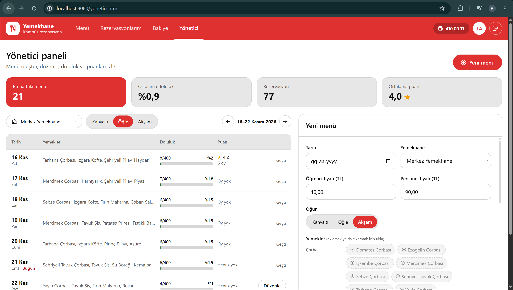

> **Şekil 2.33:** Yönetici paneli (yalnızca `yonetici` rolüne görünür; diğer roller için API
> `403` döner). Üstte haftalık özet; solda seçilen yemekhane ve öğün için **menü bazında
> doluluk** (`v_menu_doluluk`) ve **ortalama puan** (`v_menu_puan`) raporu, replikadan okunur;
> sağda menü formu.

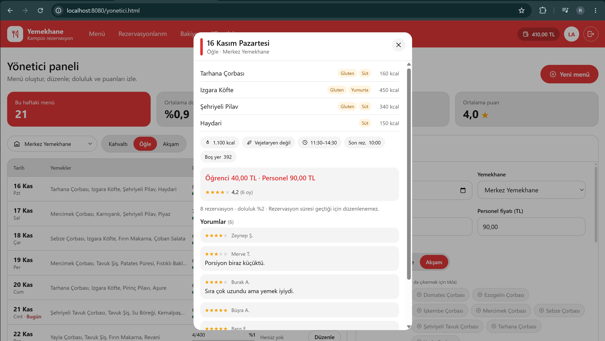

> **Şekil 2.34:** Rapordaki bir satıra tıklanınca açılan menü kartı: iki fiyat, puan, rezervasyon
> sayısı, doluluk ve yorumlar.

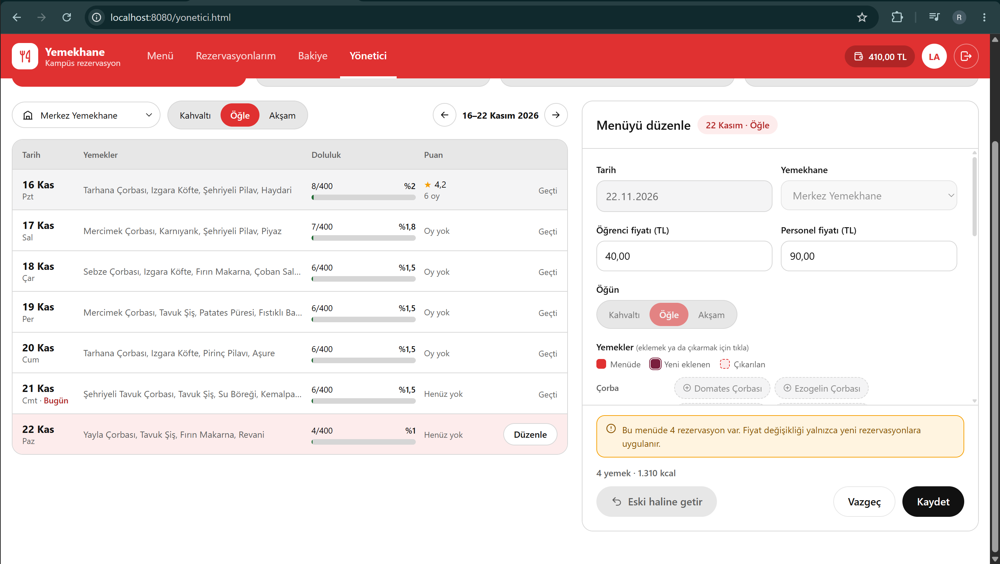

> **Şekil 2.35:** Menü düzenleme. Tarih, yemekhane ve öğün kilitlidir; fiyatlar ve yemekler
> değiştirilebilir. Rezervasyonu olan menüde fiyat değişikliğinin yalnızca yeni
> rezervasyonlara uygulanacağı belirtilir (mevcut rezervasyonun ücreti kayıtta saklıdır).

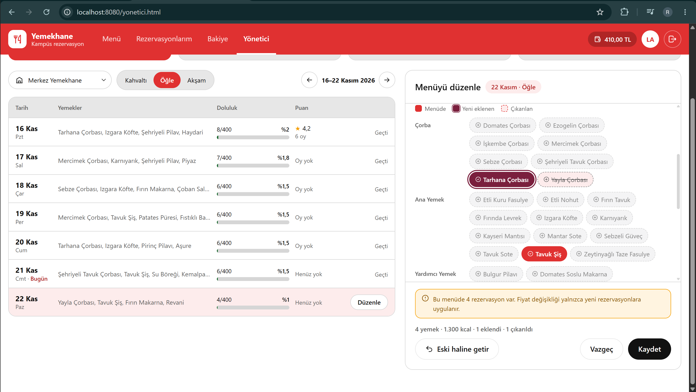

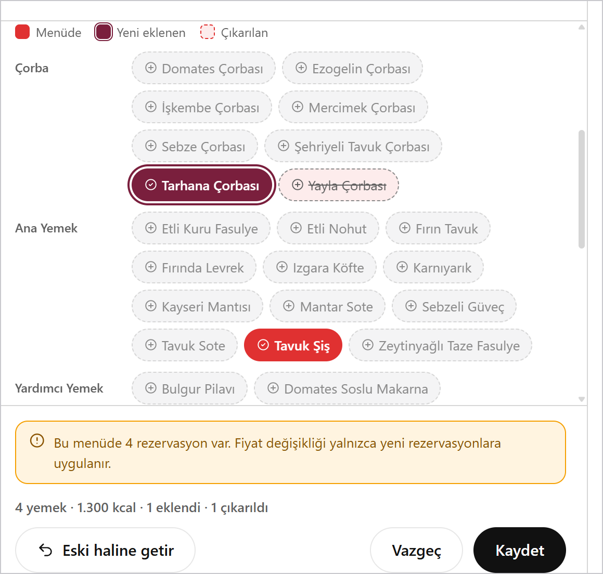

> **Şekil 2.36 ve 2.37:** Düzenlemede menüye yeni eklenen yemek bordo, çıkarılan yemek üstü
> çizili gösterilir; alt satırda _"1 eklendi · 1 çıkarıldı"_. **Eski haline getir** tüm
> değişiklikleri geri alır.

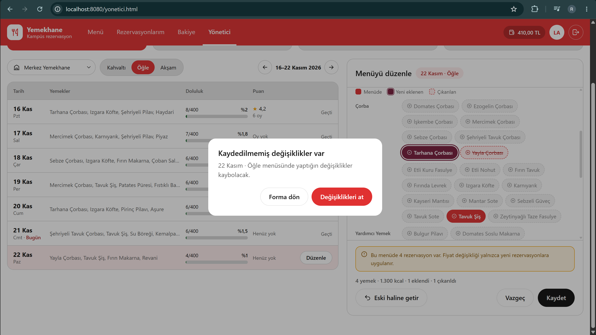

> **Şekil 2.38:** Kaydedilmemiş değişiklik varken başka menüye geçilmek istendiğinde onay
> penceresi.

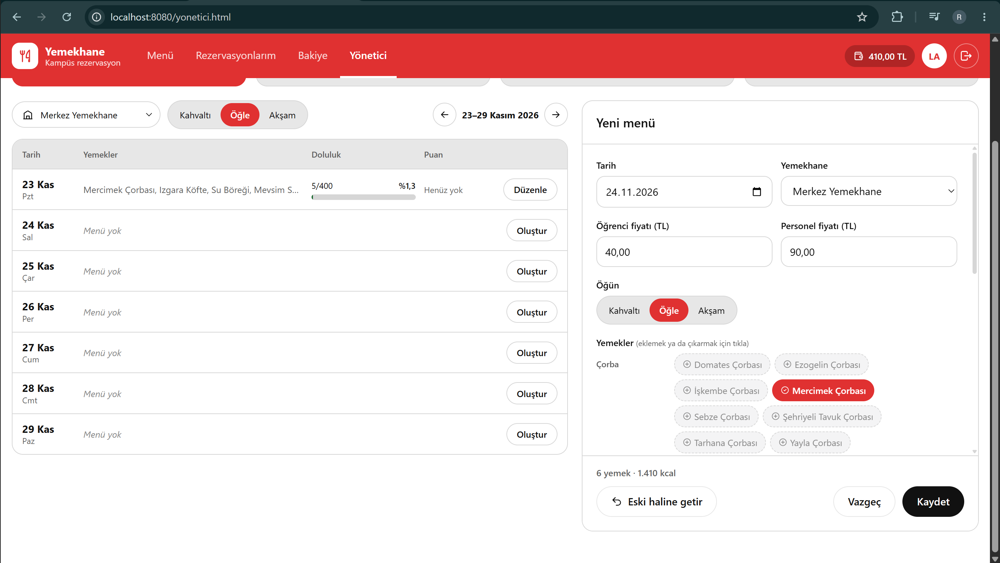

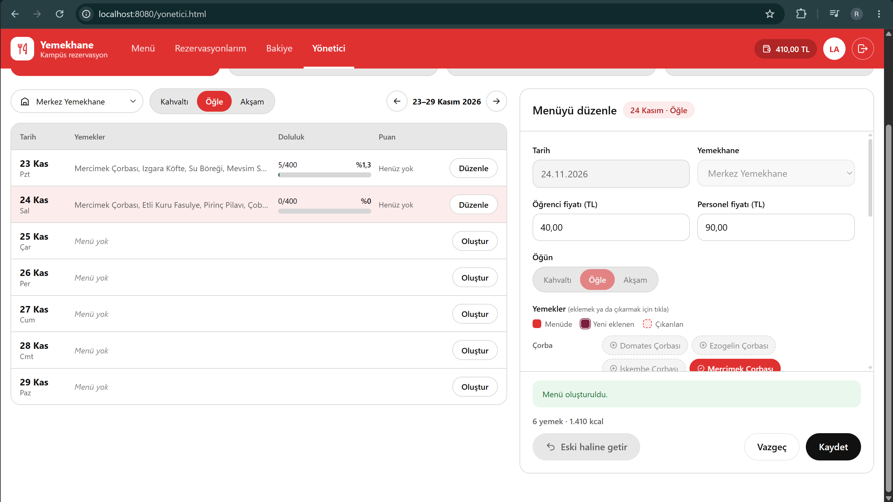

> **Şekil 2.39 ve 2.40:** 24 Kasım Öğle için yeni menü oluşturma ve sonucu
> (_"Menü oluşturuldu."_). `menuler` ve `menu_yemekleri` tablolarına **tek transaction** içinde
> yazılır; kaydedilen menü kaynaktan okunup tabloya eklenir.

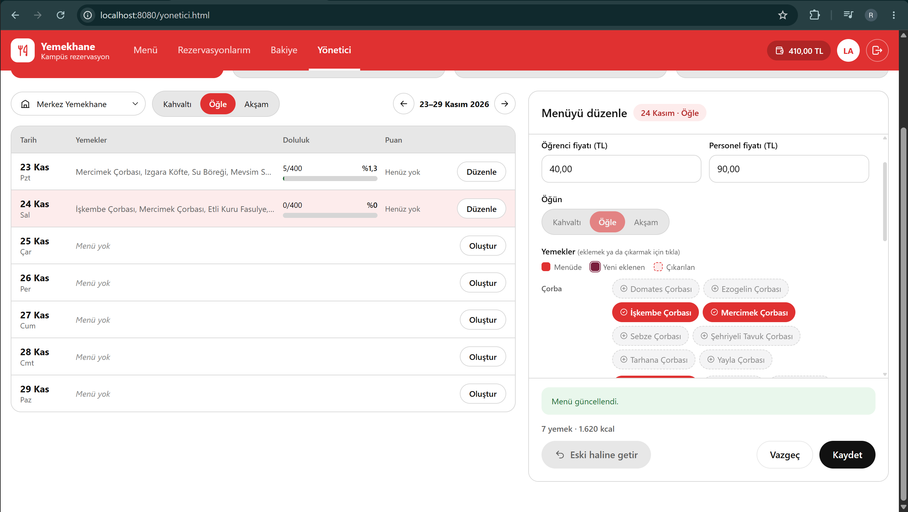

> **Şekil 2.41:** Aynı menüye yemek eklenip kaydedilmesi: _"Menü güncellendi."_ Düzenlemede
> menü satırı `SELECT ... FOR UPDATE` ile kilitlenir.

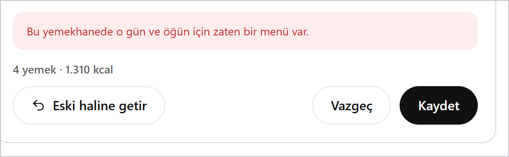

> **Şekil 2.42:** Aynı yemekhane, gün ve öğün için ikinci menü denemesi: `uq_menu`
> kısıtı (errno 1062) `409` yanıtına çevrilir: _"Bu yemekhanede o gün ve öğün için zaten bir
> menü var."_

### 2.9 Telefon Uyumu

Arayüz 375 px ve 320 px genişlikte tüm ekranlarda (açılan pencereler dahil) denetlenmiştir:
yatay kaydırma ya da taşan öğe yoktur. Telefonda üst gezinme yerine alt gezinme çubuğu
kullanılır, kart ızgaraları tek sütuna iner, menü pencereleri alttan açılan sayfaya dönüşür
ve form alanları iPhone Safari'nin otomatik yakınlaştırmasını önlemek için 16 px yazı
boyutundadır. Aşağıdaki görüntüler tarayıcının cihaz modunda (393x852, iPhone 16)
alınmış ve yalnızca telefon ekranı kırpılmıştır.

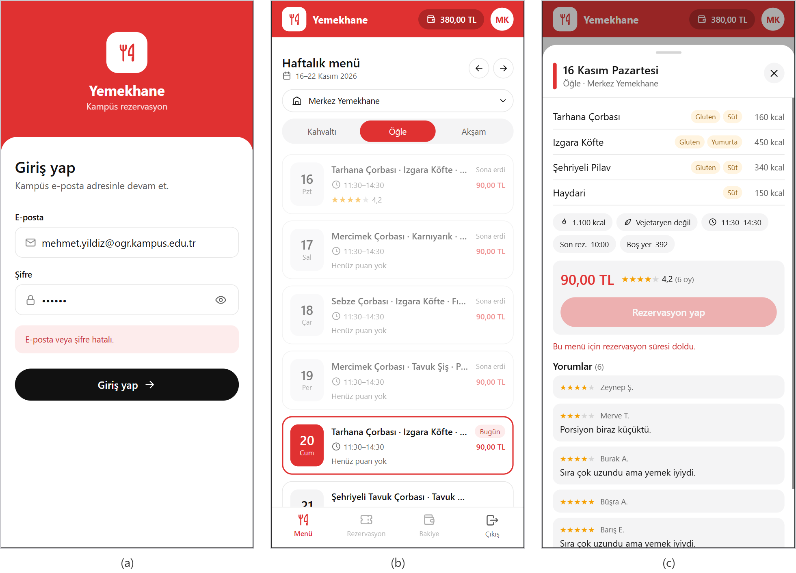

> **Şekil 2.43:** (a) Giriş ve hata mesajı, (b) haftalık menü, (c) menü penceresi.

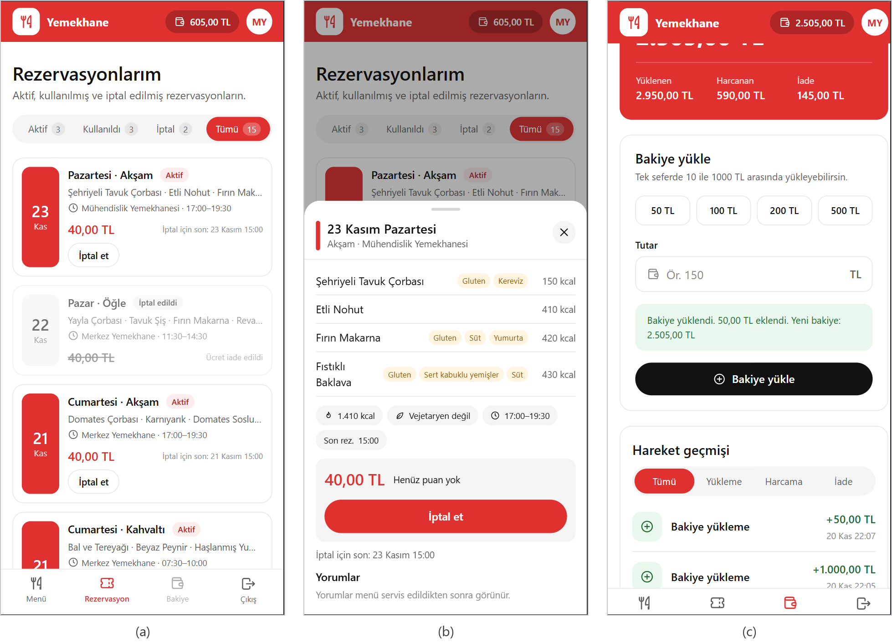

> **Şekil 2.44:** (a) Rezervasyonlarım, (b) aktif rezervasyonun detayı ve İptal et,
> (c) bakiye yükleme sonrası.

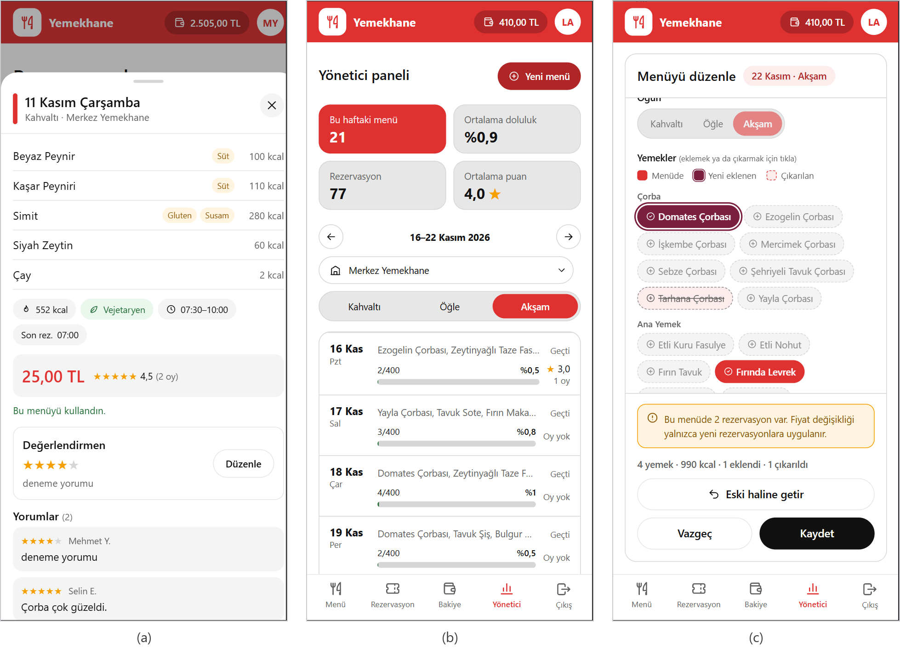

> **Şekil 2.45:** (a) Değerlendirme, (b) yönetici raporu, (c) yönetici menü düzenleme (eklenen ve
> çıkarılan yemekler).

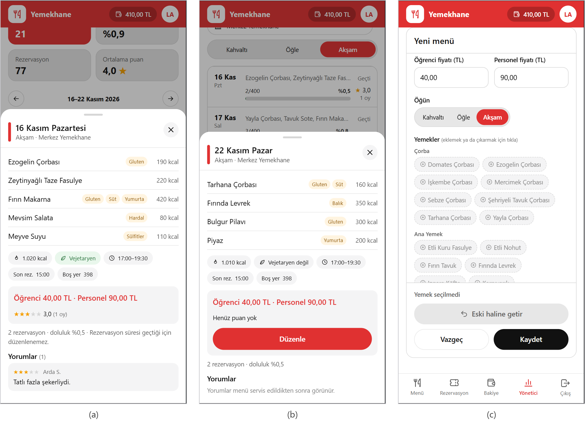

> **Şekil 2.46:** (a) Geçmiş menü kartı, (b) düzenlenebilir menü kartı, (c) yeni menü formu.

### 2.10 Sonuç

Uygulama, başlangıç paketine ek adım gerektirmeden `docker compose up -d` ile kalkan bir
`uygulama` servisi olarak eklenmiştir. Route, controller, service ve repository katmanları
ayrılmış; SQL yalnızca veri katmanında, iş kuralları API'de ve veritabanındadır. Okumalar
replikadan, yazmalar ve yazma sonrasında gösterilen değerler kaynaktan yapılarak eşzamansız
replikasyonun kullanıcıya eski veri göstermesi engellenmiştir. Para hareketleri
başlangıç paketindeki stored procedure'lerle yapılmakta ve bu yordamların hata mesajları
arayüze değiştirilmeden ulaşmaktadır. Yedi ekranın tamamı masaüstünde ve telefon
genişliğinde çalışmaktadır. Oturumlar bu aşamada uygulamanın belleğinde tutulmaktadır;
Aşama 3'te Redis'e taşınacak ve menü verisi Redis'te önbelleğe alınacaktır.

---

## Aşama 3: Redis

### 3.1 Amaç

Bu aşamada Redis iki iş için kullanılmıştır: günün menüsünün önbelleğe alınması ve oturum
bilgilerinin saklanması. Menü önbelleği, aynı menünün her açılışta veritabanından tekrar
okunmasını önler; yönetici menüyü değiştirdiğinde ilgili kayıt silinir. Oturumların Redis'e
taşınmasıyla, Aşama 2'de uygulamanın belleğinde tutulan ve container yeniden başladığında
kaybolan oturumlar artık yeniden başlatmadan etkilenmemektedir.

### 3.2 Redis'in Kullanımı

| Görev          | Anahtar                                 | Süre                                  | Ne zaman silinir                     |
| -------------- | --------------------------------------- | ------------------------------------- | ------------------------------------ |
| Menü önbelleği | `menu:{yemekhane_id}:{tarih}:{ogun_id}` | Menünün kendi gününün sonuna kadar    | Yönetici o menüyü değiştirdiğinde    |
| Oturum         | `oturum:{token}`                        | 30 dakika, her istekte yenilenir      | Çıkış yapıldığında                   |

Redis bağlantısı `config/redis.js` dosyasında `redis` paketiyle kurulur; adres ve port
compose dosyasındaki `REDIS_HOST` ve `REDIS_PORT` ortam değişkenlerinden okunur. Uygulama
açılırken önce Redis'e bağlanır, ardından istek kabul etmeye başlar. Redis'e erişen kod
Aşama 2'deki katman düzenine uygun olarak veri katmanındadır:

```
uygulama/src/
├── config/redis.js                       # Redis istemcisi
├── repositories/menuOnbellegiRepository.js   # menu:* anahtarları (getir, yaz, sil)
├── repositories/oturumRepository.js          # oturum:* anahtarları (kaydet, getir ve uzat, sil)
├── services/menuService.js               # önce önbellek, yoksa veritabanı
├── services/yoneticiService.js           # menü kaydedilince önbelleğin silinmesi
└── services/oturumService.js             # oturum oluşturma, okuma, silme
```

#### Adım 1: Uygulamanın Redis'e Bağlanması

```powershell
docker compose logs uygulama
```


> **Şekil 3.1:** Uygulama açılışında önce Redis bağlantısı kurulmuş, ardından API 8000
> portunu dinlemeye başlamıştır. `uygulama` servisi compose dosyasında `redis` servisi
> sağlıklı olmadan başlamaz.

---

### 3.3 Menü Önbelleği

Günün menüsü (`GET /api/menu`), menü sayfasındaki ve Rezervasyonlarım sayfasındaki menü
penceresinin verisidir. `menuService` önce Redis'teki anahtara bakar; kayıt varsa onu döner,
yoksa menüyü replikadan okuyup Redis'e yazar:

```js
async function menuSatirlari(yemekhaneId, tarih, ogunId) {
  const anahtar = menuOnbellegiRepository.anahtar(yemekhaneId, tarih, ogunId);
  const onbellekteki = await onbellektenOku(yemekhaneId, tarih, ogunId);
  if (onbellekteki) {
    console.log(`[önbellek] ${anahtar} Redis'ten okundu`);
    return onbellekteki;
  }

  const satirlar = await menuRepository.gununMenusunuGetir(yemekhaneId, tarih, ogunId);
  if (satirlar.length > 0) {
    const sure = await onbellegeYaz(yemekhaneId, tarih, ogunId, satirlar);
    ...
  }
  return satirlar;
}
```

- Önbellekte `v_menu_detay` view'ından gelen satırlar JSON olarak tutulur. Fiyat, kayıt
  okunduktan sonra kullanıcının rolüne göre seçildiği için öğrenci ve personel aynı kaydı
  kullanır.
- Süre, menünün tarihinin gece yarısına kalan saniye olarak verilir. Bugünün menüsü bu gece,
  yarının menüsü yarın gece silinir. Geçmiş bir günün menüsü önbelleğe yazılmaz.
- Menüsü olmayan bir gün için boş sonuç önbelleğe yazılmaz.
- Redis'e ulaşılamazsa hata günlüğe yazılır ve menü veritabanından okunmaya devam eder.

#### Adım 2: İlk İstek Veritabanından, İkincisi Redis'ten

Menü sayfasında bugünün (23 Kasım) Öğle menüsünün penceresi iki kez açılmış, ardından
uygulama günlüğüne bakılmıştır.

```powershell
docker compose logs --tail 5 uygulama
```


> **Şekil 3.2:** İlk açılışta `menu:1:2026-11-23:2` anahtarı Redis'te yoktur; menü
> veritabanından okunmuş ve 40.607 saniyelik süreyle Redis'e yazılmıştır. İkinci açılışta
> aynı menü Redis'ten okunmuştur.

#### Adım 3: Redis'teki Menü Kaydı

```powershell
docker compose exec redis redis-cli KEYS "menu:*"
docker compose exec redis redis-cli TTL menu:1:2026-11-23:2
docker compose exec redis redis-cli --raw GET menu:1:2026-11-23:2
```


> **Şekil 3.3:** Redis'teki tek menü anahtarı, kaydın gece yarısına kalan süresi (38.230
> saniye) ve kaydın içeriği. `GET` çıktısında Öğle menüsünün beş yemeği; yemek adı, kategori,
> kalori, vejetaryen ve alerjen bilgisiyle birlikte görülmektedir. Türkçe karakterlerin
> okunabilmesi için `redis-cli`'ye `--raw` seçeneği verilmiştir.

---

### 3.4 Menü Değişince Önbelleğin Silinmesi

Yönetici panelinde bir menü oluşturulduğunda ya da düzenlendiğinde, `yoneticiService`
veritabanına yazma tamamlandıktan sonra o menünün anahtarını Redis'ten siler. Böylece bir
sonraki istek menüyü veritabanından yeni hâliyle okur.

Silme işlemi **iki saniye sonra bir kez daha** yapılır. Bölüm 2.6'da anlatıldığı gibi okumalar
replikadan yapılır ve replikasyon eşzamansızdır. Silmeyle replikanın değişikliği uygulaması
arasındaki kısa sürede gelen bir istek, menünün eski hâlini replikadan okuyup önbelleğe
yeniden yazabilir; bu durumda eski menü günün sonuna kadar gösterilirdi. İkinci silme bu
olasılığı ortadan kaldırır. Arada istek gelmemişse kayıt zaten silinmiş olur ve günlüğe
_"önbellekte yoktu"_ yazılır.

#### Adım 4: Yönetici Menüyü Günceller

Menü sayfasında 24 Kasım Öğle menüsünün penceresi açılarak menü önbelleğe alınmış, ardından
yönetici panelinde bu menüye yemek eklenip kaydedilmiştir.


> **Şekil 3.4 ve 3.5:** Yönetici panelinde 24 Kasım Öğle menüsünün kaydedilmesi ve formun
> yakınlaştırması: _"Menü güncellendi."_ Menüye Sütlaç ve Mevsim Meyvesi eklenmiştir.

#### Adım 5: Önbellekteki Kaydın Silinmesi

```powershell
docker compose logs --tail 6 uygulama
docker compose exec redis redis-cli EXISTS menu:1:2026-11-24:2
```


> **Şekil 3.6:** 24 Kasım menüsü ilk açılışta veritabanından okunmuş ve **123.279 saniyelik**
> (yaklaşık 34 saat, 24 Kasım'ın sonuna kadar) süreyle önbelleğe yazılmış, sonraki açılışlar
> Redis'ten yapılmıştır. Yönetici kaydettiğinde kayıt silinmiş (_"silindi (menü
> kaydedildi)"_), iki saniye sonraki ikinci silmede kayıt artık bulunmamıştır. `EXISTS`
> komutu anahtarın Redis'te olmadığını (`0`) göstermektedir.

#### Adım 6: Arayüzde Yeni Menü


> **Şekil 3.7:** Kayıttan sonra öğrenci hesabıyla açılan 24 Kasım Öğle penceresi. Menü
> veritabanından yeni hâliyle okunduğu için eklenen Sütlaç listede görünmektedir. Bu görüntü,
> Şekil 3.4'teki kayıttan önce yalnızca Sütlaç eklendiğinde alınmıştır.

---

### 3.5 Oturumların Redis'te Tutulması

Aşama 2'de oturumlar uygulamanın belleğindeki bir `Map` nesnesinde tutuluyordu ve
`uygulama` container'ı her yeniden başladığında bütün kullanıcıların oturumu kapanıyordu. Bu
aşamada oturumlar `oturumRepository` üzerinden Redis'e taşınmıştır:

- Girişte rastgele bir anahtar (UUID) üretilir ve `oturum:{token}` anahtarına kullanıcının
  kimliği ve rolü 1800 saniyelik süreyle yazılır.
- Oturum gerektiren her istekte kayıt `GETEX` komutuyla okunur; bu komut süreyi yeniden 1800
  saniyeye ayarlar. Böylece kullanıcı işlem yaptığı sürece oturum açık kalır, 30 dakika hiçbir
  istek gelmezse kendiliğinden silinir.
- Çıkışta (`POST /api/cikis`) anahtar silinir.

```js
async function getirVeUzat(token) {
  const deger = await redisIstemcisi.getEx(anahtar(token), { type: 'EX', value: OTURUM_SURESI });
  return deger ? JSON.parse(deger) : null;
}
```

Arayüz kodunda değişiklik gerekmemiştir; tarayıcı oturum anahtarını yine `Authorization`
başlığıyla gönderir.

#### Adım 7: Redis'teki Oturum Kaydı

```powershell
docker compose exec redis redis-cli --scan --pattern "oturum:*"
docker compose exec redis redis-cli GET oturum:1c2048c2-61d2-41b4-9287-5e1eebbd0e63
docker compose exec redis redis-cli TTL oturum:1c2048c2-61d2-41b4-9287-5e1eebbd0e63
```


> **Şekil 3.8:** Öğrenci (Mehmet) ve yönetici (Leyla) için iki oturum anahtarı. Öğrencinin
> kaydında kullanıcı kimliği (`7`) ve rolü (`ogrenci`) tutulmaktadır; parola ya da kişisel
> bilgi saklanmaz. Kalan süre 1736 saniyedir.

#### Adım 8: Sürenin Her İstekte Yenilenmesi

Aynı `TTL` komutu öğrencinin sayfasına dokunulmadan art arda çalıştırılmış, ardından
tarayıcıda sayfa yenilenip (F5) komut bir kez daha çalıştırılmıştır.

```powershell
docker compose exec redis redis-cli TTL oturum:1c2048c2-61d2-41b4-9287-5e1eebbd0e63
```


> **Şekil 3.9:** Kalan süre istek gelmediği sürece azalmaktadır (1391, 1338, 1330 saniye).
> Sayfa yenilendiğinde tarayıcının API'ye gönderdiği istekle süre yeniden 1800 saniyeye
> ayarlanmıştır (1797).

#### Adım 9: Uygulama Yeniden Başladığında Oturumun Korunması

```powershell
docker compose restart uygulama
docker compose ps uygulama
```


> **Şekil 3.10:** `uygulama` container'ı yeniden başlatılmıştır; `docker compose ps` çıktısında
> container'ın 14 saniyedir çalıştığı (`Up 14 seconds (healthy)`) görülmektedir.


> **Şekil 3.11:** Yeniden başlatmadan sonra öğrencinin sayfası yenilendiğinde giriş ekranına
> dönülmemiş, haftalık menü oturum açık olarak gelmiştir. Oturum bilgisi uygulamanın belleğinde
> değil Redis'te olduğu için yeniden başlatmadan etkilenmemiştir.

#### Adım 10: Çıkışta Oturumun Silinmesi

Öğrenci arayüzdeki çıkış düğmesiyle oturumu kapatmış, anahtarlar çıkıştan önce ve sonra
listelenmiştir.

```powershell
docker compose exec redis redis-cli --scan --pattern "oturum:*"
```


> **Şekil 3.12:** Çıkıştan önce iki oturum anahtarı vardır. Çıkıştan sonra öğrencinin anahtarı
> (`bde7efc7...`) silinmiş, yalnızca yöneticinin anahtarı kalmıştır. Bu görüntü Şekil 3.8'den önce
> alınmıştır; öğrenci daha sonra yeniden giriş yaptığında yeni bir anahtar (`1c2048c2...`) üretilmiştir.

### 3.6 Sonuç

Redis, menü önbelleği ve oturum deposu olarak kullanılmaktadır. Günün menüsü ilk istekte
veritabanından okunup menünün gününün sonuna kadar önbellekte tutulmakta, sonraki istekler
Redis'ten karşılanmakta ve bu durum uygulama günlüğünde görülmektedir. Yönetici bir menüyü
değiştirdiğinde ilgili kayıt silinmekte; replikasyon gecikmesi nedeniyle eski verinin yeniden
önbelleğe yazılması iki saniye sonraki ikinci silmeyle önlenmektedir. Oturumlar 30 dakikalık,
her istekte yenilenen bir süreyle Redis'te tutulmakta, çıkışta silinmekte ve uygulama
container'ı yeniden başladığında korunmaktadır.

---

<!-- Aşama 4 bölümü aşama tamamlandığında eklenecektir. -->
