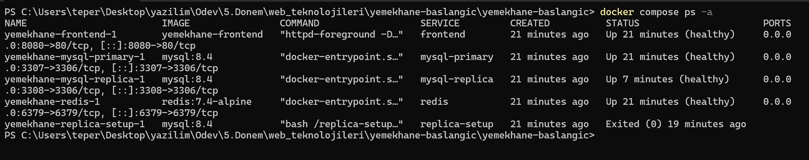
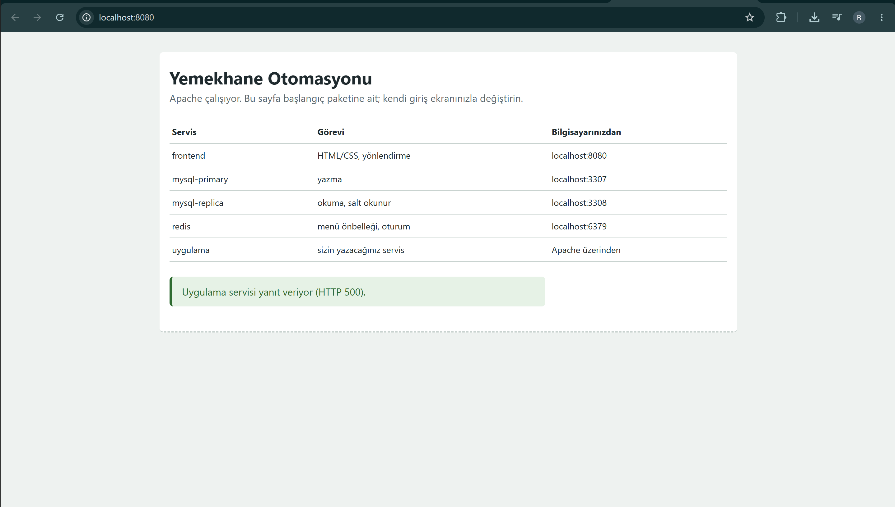
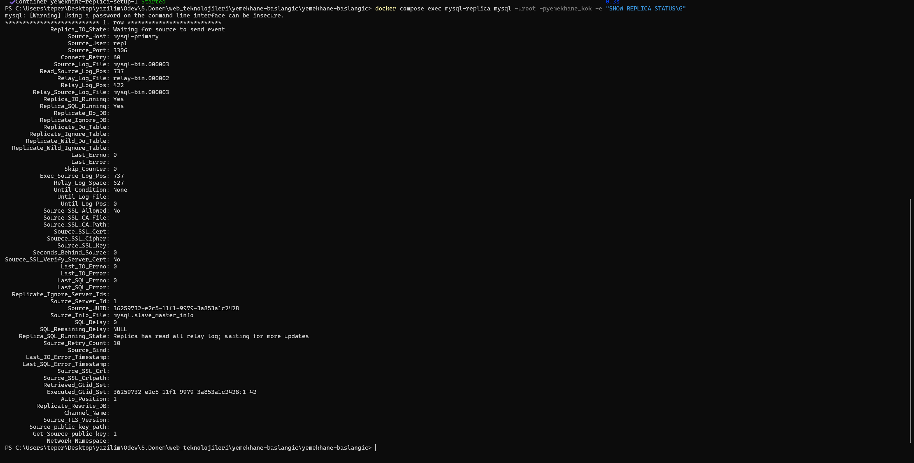
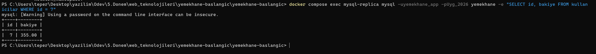
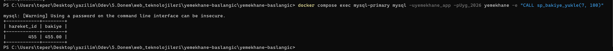

# Yemekhane Otomasyonu · Dönem Ödevi Raporu

## Aşama 1 · Altyapı

### 1.1 Amaç

Bu aşamada başlangıç paketinin sağladığı beş servis (`mysql-primary`, `mysql-replica`,
`replica-setup`, `redis`, `frontend`) tek komutla ayağa kaldırılmış; servislerin sağlık
durumları, MySQL kaynak–replika replikasyonu, replikanın salt okunur oluşu ve replikanın
kesinti sonrası veri yakalama yeteneği komut çıktılarıyla doğrulanmıştır.

### 1.2 Test Ortamı

|                     |                             |
| ------------------- | --------------------------- |
| İşletim sistemi     | Windows 11 Pro              |
| Konteyner platformu | Docker Desktop (Compose v2) |
| Terminal            | Windows PowerShell          |
| Test tarihi         | 17.11.2026                  |
| Test kullanıcısı    | `id = 7` (öğrenci)          |

### 1.3 Servis Mimarisi

| Servis          | İmaj                              | Görev                                                | Dış Port |
| --------------- | --------------------------------- | ---------------------------------------------------- | -------- |
| `mysql-primary` | `mysql:8.4`                       | Kaynak sunucu, tüm yazma işlemleri                   | `3307`   |
| `mysql-replica` | `mysql:8.4`                       | Replika sunucu, okuma işlemleri ve salt okunur yedek | `3308`   |
| `replica-setup` | `mysql:8.4`                       | Replikasyonu bir kez kurar ve çıkar                  | —        |
| `redis`         | `redis:7.4-alpine`                | Menü önbelleği ve oturum deposu                      | `6379`   |
| `frontend`      | `httpd:2.4-alpine` (özel derleme) | HTML/CSS sunumu, uygulamaya yönlendirme              | `8080`   |

Replikasyon **GTID tabanlıdır** (`--gtid-mode=ON`, `SOURCE_AUTO_POSITION = 1`). Bu sayede
replika, konum (binlog dosyası/ofset) bilgisi tutmadan, kaynakta hangi işlemleri henüz
uygulamadığını kendisi belirleyebilir.

---

### 1.4 Doğrulama Adımları

#### Adım 1 · Sistemin Ayağa Kaldırılması

```powershell
docker compose up -d
```


> **Şekil 1.1 —** `docker compose up -d` çıktısı. İlk çalıştırmada `redis:7.4-alpine` ve
> `mysql:8.4` imajları Docker Hub'dan indirilmiş, `frontend` servisi ise `apache/Dockerfile`
> üzerinden yerel olarak derlenmiştir (`yemekhane-frontend` imajı). Üç kalıcı volume
> (`mysql-primary-veri`, `mysql-replica-veri`, `redis-veri`) ve servislerin birbirine ad
> üzerinden ulaştığı `yemekhane_default` ağı oluşturulmuştur. `mysql-primary` ve
> `mysql-replica` container'ları **Healthy** durumuna geçtikten sonra `replica-setup`
> başlatılmıştır; bu sıralama `depends_on: condition: service_healthy` ile sağlanır.

---

#### Adım 2 · Servis Durumlarının Kontrolü

```powershell
docker compose ps -a
```



> **Şekil 1.2 —** Tüm servislerin durum tablosu. `frontend`, `mysql-primary`,
> `mysql-replica` ve `redis` servisleri **`Up (healthy)`** durumundadır; yani her birinin
> `healthcheck` komutu (`wget`, `mysqladmin ping`, `redis-cli ping`) başarıyla yanıt
> vermektedir. `replica-setup` servisi **`Exited (0)`** durumundadır. Bu servis tek seferlik
> bir kurulum görevidir; replikasyonu kurup başarı koduyla (0) çıkması beklenen davranıştır.
> `mysql-replica` servisinin diğerlerinden daha kısa süredir çalışıyor görünmesi
> (_Up 7 minutes_), Adım 7'deki durdurma–başlatma testinden kaynaklanmaktadır; bu ekran
> görüntüsü testlerin tamamlanmasından sonra alınmıştır.

---

#### Adım 3 · Web Arayüzüne Erişim

Tarayıcıdan `http://localhost:8080` adresine gidilmiştir.



> **Şekil 1.3 —** Apache 2.4 tarafından sunulan başlangıç sayfası. Sayfa, servislerin
> görevlerini ve bilgisayardan erişim portlarını listelemektedir. Alt kısımdaki
> _"Uygulama servisi yanıt veriyor (HTTP 500)"_ bildirimi, `uygulama` servisinin bu aşamada
> henüz compose dosyasına eklenmemiş olmasından kaynaklanır: Apache, `/api/` isteğini
> `http://uygulama:8000` adresine iletmeye çalışmakta, ancak bu ada sahip bir container
> bulunmadığı için hata döndürmektedir. Uygulama servisi Aşama 2'de eklenecektir.

---

#### Adım 4 · Replikasyon Durumunun Doğrulanması

```powershell
docker compose exec mysql-replica mysql -uroot -pyemekhane_kok -e "SHOW REPLICA STATUS\G"
```



> **Şekil 1.4 —** Replika sunucusundaki replikasyon durumu. Kritik alanlar:
>
> | Alan                               | Değer                            | Anlamı                                                                |
> | ---------------------------------- | -------------------------------- | --------------------------------------------------------------------- |
> | `Replica_IO_Running`               | **Yes**                          | Kaynaktan binlog olaylarını çeken iş parçacığı çalışıyor              |
> | `Replica_SQL_Running`              | **Yes**                          | Alınan olayları replikaya uygulayan iş parçacığı çalışıyor            |
> | `Source_Host` / `Source_User`      | `mysql-primary` / `repl`         | Replika, kaynağa yalnızca replikasyon yetkili kullanıcıyla bağlanıyor |
> | `Seconds_Behind_Source`            | `0`                              | Ölçüm anında replika kaynağın gerisinde değil                         |
> | `Last_IO_Errno` / `Last_SQL_Errno` | `0` / `0`                        | Hata yok                                                              |
> | `Auto_Position`                    | `1`                              | GTID ile otomatik konumlandırma etkin                                 |
> | `Replica_SQL_Running_State`        | _Replica has read all relay log_ | Bekleyen işlem yok, yeni olaylar bekleniyor                           |

---

#### Adım 5 · Kaynaktaki Yazmanın Replikaya Aktarılması

Önce replikadaki mevcut bakiye okunmuş, ardından kaynakta `sp_bakiye_yukle` yordamıyla
100 TL yükleme yapılmış ve replika tekrar sorgulanmıştır.

**5a. Replikada başlangıç bakiyesi**

```powershell
docker compose exec mysql-replica mysql -uyemekhane_app -pUyg_2026 yemekhane -e "SELECT id, bakiye FROM kullanicilar WHERE id = 7"
```



> **Şekil 1.5 —** Yükleme öncesinde replikadan okunan bakiye: **355,00 TL**. Bu değer,
> karşılaştırma için referans noktasıdır.

**5b. Kaynakta 100 TL yükleme**

```powershell
docker compose exec mysql-primary mysql -uyemekhane_app -pUyg_2026 yemekhane -e "CALL sp_bakiye_yukle(7, 100)"
```



> **Şekil 1.6 —** Yazma işlemi **kaynak sunucuya** (`mysql-primary`) gönderilmiştir. Para
> hareketi doğrudan `UPDATE` ile değil, ödevin kuralı gereği `sp_bakiye_yukle` stored
> procedure'ü ile yapılmıştır. Yordam, `bakiye_hareketleri` tablosuna **455** numaralı
> hareketi ekleyip kullanıcının yeni bakiyesini (**455,00 TL**) tek satır olarak döndürmüştür.

**5c. Replikada güncel bakiye**

```powershell
docker compose exec mysql-replica mysql -uyemekhane_app -pUyg_2026 yemekhane -e "SELECT id, bakiye FROM kullanicilar WHERE id = 7"
```


> **Şekil 1.7 —** Aynı sorgu replikada tekrarlandığında bakiye **455,00 TL** olarak
> okunmuştur. Kaynakta yapılan yazma, herhangi bir elle müdahale olmadan replikaya
> aktarılmıştır: **355 + 100 = 455** ✔

---

#### Adım 6 · Replikaya Yazma Denemesinin Reddedilmesi

```powershell
docker compose exec mysql-replica mysql -uyemekhane_app -pUyg_2026 yemekhane -e "CALL sp_bakiye_yukle(7, 50)"
```


> **Şekil 1.8 —** Replika üzerinde yazma denemesi
> **`ERROR 1290 (HY000): The MySQL server is running with the --super-read-only option`**
> hatasıyla reddedilmiştir. `replica-setup.sh` betiği replikada `read_only` ve
> `super_read_only` değişkenlerini `SET PERSIST` ile kalıcı olarak açmaktadır; bu nedenle
> ayar container yeniden başlatıldığında da korunur. Uygulama kullanıcısına replikada yazma
> yetkisi bilinçli olarak verilmiştir; böylece reddin sebebinin **yetki eksikliği değil,
> sunucunun salt okunur olması** olduğu açıkça görülmektedir. Bu sayede uygulama
> katmanındaki bir hata sonucu yanlışlıkla replikaya yazılması veritabanı düzeyinde
> engellenmiş olur.

---

#### Adım 7 · Kesinti Sonrası Değişikliklerin Yakalanması

Replika container'ı durdurulmuş, replika kapalıyken kaynakta 200 TL yükleme yapılmış,
ardından replika yeniden başlatılarak bakiye sorgulanmıştır.

```powershell
docker compose stop mysql-replica
docker compose exec mysql-primary mysql -uyemekhane_app -pUyg_2026 yemekhane -e "CALL sp_bakiye_yukle(7, 200)"
docker compose start mysql-replica
docker compose exec mysql-replica mysql -uyemekhane_app -pUyg_2026 yemekhane -e "SELECT id, bakiye FROM kullanicilar WHERE id = 7"
```


> **Şekil 1.9 —** Dört adımlık kesinti testi:
>
> 1. `mysql-replica` durduruldu (**Stopped**).
> 2. Replika kapalıyken kaynakta 200 TL yüklendi → hareket **456**, kaynaktaki bakiye **655,00 TL**.
> 3. `mysql-replica` yeniden başlatıldı (**Started**).
> 4. Replikada sorgulanan bakiye **655,00 TL** → **455 + 200 = 655** ✔
>
> Replika, yeniden başladığında kaynağa bağlanmış ve GTID kümesini karşılaştırarak kapalı
> olduğu sürede kaçırdığı işlemi kendiliğinden almış ve uygulamıştır. Herhangi bir elle
> senkronizasyon gerekmemiştir. Bu davranış, replikanın kaynak çöktüğünde güncel bir yedek
> olarak kullanılabilmesinin temelidir.

---

#### Adım 8 · Redis Erişimi

```powershell
docker compose exec redis redis-cli ping
```


> **Şekil 1.10 —** Redis sunucusu `PING` komutuna **`PONG`** yanıtı vermiştir. Redis, AOF
> (`--appendonly yes`) kalıcılığıyla çalışmaktadır; Aşama 3'te menü önbelleği ve oturum
> deposu olarak kullanılacaktır.

---

### 1.5 Bakiye Akışının Özeti

| Adım | İşlem                                          | Sunucu  | Hareket No | Bakiye                      |
| ---- | ---------------------------------------------- | ------- | ---------- | --------------------------- |
| 5a   | Başlangıç okuma                                | Replika | —          | 355,00 TL                   |
| 5b   | `sp_bakiye_yukle(7, 100)`                      | Kaynak  | 455        | 455,00 TL                   |
| 5c   | Okuma                                          | Replika | —          | 455,00 TL ✔                 |
| 6    | `sp_bakiye_yukle(7, 50)`                       | Replika | —          | **Reddedildi** (ERROR 1290) |
| 7    | Replika durduruldu → `sp_bakiye_yukle(7, 200)` | Kaynak  | 456        | 655,00 TL                   |
| 7    | Replika başlatıldı → okuma                     | Replika | —          | 655,00 TL ✔                 |

Replikaya yapılan 50 TL'lik deneme reddedildiği için bakiyeye yansımamıştır; son bakiye
yalnızca kaynakta yapılan iki yüklemeyi içermektedir: **355 + 100 + 200 = 655 TL**.

### 1.6 Değerlendirme Ölçütlerinin Karşılanması

| Ödev Ölçütü                                                                            | Kanıt           | Sonuç |
| -------------------------------------------------------------------------------------- | --------------- | ----- |
| `docker compose ps` çıktısında tüm servisler healthy, `replica-setup` başarıyla çıkmış | Şekil 1.2       | ✅    |
| Kaynakta yapılan bakiye yüklemesi replikada görünüyor                                  | Şekil 1.5 – 1.7 | ✅    |
| Replikaya yazma denemesi read-only hatasıyla reddediliyor                              | Şekil 1.8       | ✅    |
| Replika durdurulup başlatıldığında aradaki değişiklikleri yakalıyor                    | Şekil 1.9       | ✅    |
| Raporda her maddenin komutu ve çıktısı var                                             | Bölüm 1.4       | ✅    |

### 1.7 Sonuç

Başlangıç paketi `docker compose up -d` komutuyla ek bir adım gerektirmeden çalışmış ve
beş servisin tamamı beklenen duruma ulaşmıştır. MySQL kaynak–replika replikasyonu GTID
tabanlı olarak çalışmakta; yazma işlemleri kaynakta yapılıp kısa süre içinde replikaya
aktarılmakta (replikasyon eşzamansız olduğundan bu aktarım anlık değildir; etkisi Aşama 2'de
ele alınacaktır), replika salt okunur olduğu için yazma girişimlerini reddetmekte ve kesinti
sonrasında kaçırdığı değişiklikleri otomatik olarak yakalamaktadır. Altyapı, Aşama 2'de
eklenecek uygulama servisinin okuma/yazma trafiğini ayırabilmesi için hazırdır.

---

<!-- Aşama 2, 3 ve 4 bölümleri ilgili aşamalar tamamlandıkça eklenecektir. -->
